# Guía de administración (dueño y administradores)

DOC-018, actualizada con P24.6 y P24.6b (coordinación libre y jornada) y con P25.6 (Insumos). Cómo usar la plataforma de Extendiendo Servicios desde la oficina: cargar clientes, sedes, servicios y personal, armar el cronograma, asignar empleados a los turnos y seguir la operación del día, incluida la jornada de los coordinadores.

**Novedad:** los coordinadores **ya no se asignan a los turnos**. Cada coordinador ve todos los turnos del día, elige cuál supervisar desde su celular y lleva su propia jornada. Lo que se carga desde la oficina son sus **clientes y sedes preferenciales** (para ordenarles la lista) y, si hace falta, las **correcciones** de su jornada.

Esta guía sirve para el **dueño** y para los **administradores**. Lo que solo puede hacer el dueño, o lo que un administrador puede hacer únicamente si el dueño le dio un permiso, está marcado así:

- **Solo dueño:** el administrador no ve ese botón o esa pantalla.
- **Permiso "…":** el administrador lo ve solo si el dueño le activó ese permiso (ver [Quién puede qué](#quién-puede-qué)).

Las imágenes son de ejemplo, con datos inventados. Esta guía cubre solo la **Plataforma Base**; al final hay una lista de lo que queda afuera.

## Índice

1. [Quién puede qué](#quién-puede-qué)
2. [Entrar, instalar y salir](#entrar-instalar-y-salir)
3. [Recorrido por la pantalla](#recorrido-por-la-pantalla)
4. [Puesta en marcha: en qué orden cargar todo](#puesta-en-marcha-en-qué-orden-cargar-todo)
5. [Clientes y sedes](#clientes-y-sedes)
6. [Tareas de cada servicio (plantillas)](#tareas-de-cada-servicio-plantillas)
7. [Servicios y turnos](#servicios-y-turnos)
8. [Asignar personal](#asignar-personal)
9. [Empleados y coordinadores](#empleados-y-coordinadores)
10. [Coordinadores: sedes preferenciales, jornadas y correcciones](#coordinadores-sedes-preferenciales-jornadas-y-correcciones)
11. [Seguir el día: Resumen y Asistencia](#seguir-el-día-resumen-y-asistencia)
12. [Fotos y videos](#fotos-y-videos)
13. [Supervisiones y calificaciones](#supervisiones-y-calificaciones)
14. [Insumos y control de stock](#insumos-y-control-de-stock)
15. [Configuración](#configuración)
16. [Usar la administración desde el celular](#usar-la-administración-desde-el-celular)
17. [Lo que no incluye la Plataforma Base](#lo-que-no-incluye-la-plataforma-base)
18. [Cuando algo no anda](#cuando-algo-no-anda)

---

## Quién puede qué

Hay dos roles de administración:

- **Dueño:** puede todo. Es la única persona que da permisos a los administradores.
- **Administrador:** puede cargar y operar casi todo, pero algunas acciones necesitan un **permiso** que le da el dueño.

### Los ocho permisos de un administrador

El dueño los activa por persona (ver [Usuarios y roles](#usuarios-y-roles)). Sin el permiso, el botón directamente no aparece.

| Permiso                        | Qué habilita                                                                                                                                                                             |
| ------------------------------ | ---------------------------------------------------------------------------------------------------------------------------------------------------------------------------------------- |
| Gestionar usuarios             | Dar de alta empleados y coordinadores; resetear contraseñas, cambiar emails, cerrar sesiones y desactivar a empleados y coordinadores                                                    |
| Cancelar turnos                | **Cancelar turno**                                                                                                                                                                       |
| Editar calificaciones          | Corregir las calificaciones que cargaron los coordinadores                                                                                                                               |
| Editar plantillas de tareas    | Crear y cambiar las listas de tareas de clientes y sedes                                                                                                                                 |
| Registrar asistencia por otros | **Registrar en nombre** de un empleado; asignar o quitar personal una vez que el turno ya empezó; corregir las jornadas de los coordinadores                                             |
| Generar turnos del mes         | **Generar turnos del mes**                                                                                                                                                               |
| Gestionar supervisiones        | Cargar y quitar los clientes y sedes preferenciales de los coordinadores; cancelar supervisiones                                                                                         |
| Gestionar stock                | Cargar el catálogo de insumos y sus precios; registrar ingresos, ajustes, retiros en nombre de otra persona y controles; anular movimientos (ver [Insumos](#insumos-y-control-de-stock)) |

### Lo que es solo del dueño

- Dar de alta **administradores** y **editar roles y permisos** de cualquier persona.
- **Reactivar** a una persona dada de baja o desactivada.
- Cambiar el **nombre de la empresa**, el **teléfono de soporte** y el **texto de consentimiento de ubicación**.
- Las pantallas **Feriados**, **Criterios de calificación** y **Eventos de seguridad**.
- Ver el **último ingreso** de cada usuario en la lista de usuarios.

Todo lo demás lo hacen igual el dueño y los administradores: clientes, sedes, servicios, turnos, asignaciones, empleados y coordinadores (con el permiso que corresponda), seguimiento del día y consulta de supervisiones.

---

## Entrar, instalar y salir

### Iniciar sesión

1. Abrí la dirección de la plataforma en **Chrome**, **Edge** o **Safari**.
2. Escribí tu **Email** y tu **Contraseña** y tocá **Ingresar**.
3. En computadora entrás a **Resumen**. En celular también (la pantalla se adapta).

La sesión queda abierta en ese dispositivo. En una computadora compartida, cerrala siempre al terminar.

### Si te olvidaste la contraseña

1. En la pantalla de ingreso tocá **¿Olvidaste tu contraseña?**
2. Escribí tu email y tocá **Mandar instrucciones**.
3. Abrí el correo (mirá en **Spam** si no está) y tocá el enlace.
4. Elegí una contraseña nueva de al menos 8 caracteres y volvé a ingresar.

Si no llega el correo, el dueño puede resetear tu contraseña desde **Configuración**, **Usuarios** (ver [Usuarios y roles](#usuarios-y-roles)). Más ayuda: [`troubleshooting.md`](troubleshooting.md#1-ingreso-y-sesión).

### Tu perfil y cambiar la contraseña

Tocá tu foto (arriba a la derecha) y elegí **Mi perfil**.

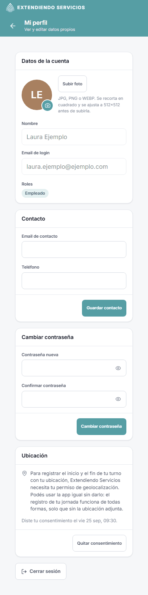

Ahí podés subir tu foto, cargar tu email de contacto y tu teléfono, y **Cambiar contraseña** (al menos 8 caracteres).

### Instalar la plataforma en el celular

Desde el celular, la primera vez que entrás aparece un cartel para **instalarla**: queda un ícono en la pantalla de inicio y se abre a pantalla completa. En Android, tocá **Instalar** (o los tres puntitos de Chrome y **Instalar aplicación**). En iPhone, abrila en **Safari**, tocá **Compartir**, **Agregar a pantalla de inicio** y **Agregar**. Los pasos completos están en la [guía del empleado](guia-empleado.md#instalar-la-app-en-tu-celular).

### Cerrar sesión

Tocá tu foto (arriba a la derecha) y elegí **Cerrar sesión**. En el celular también está en **Más**.

---

## Recorrido por la pantalla

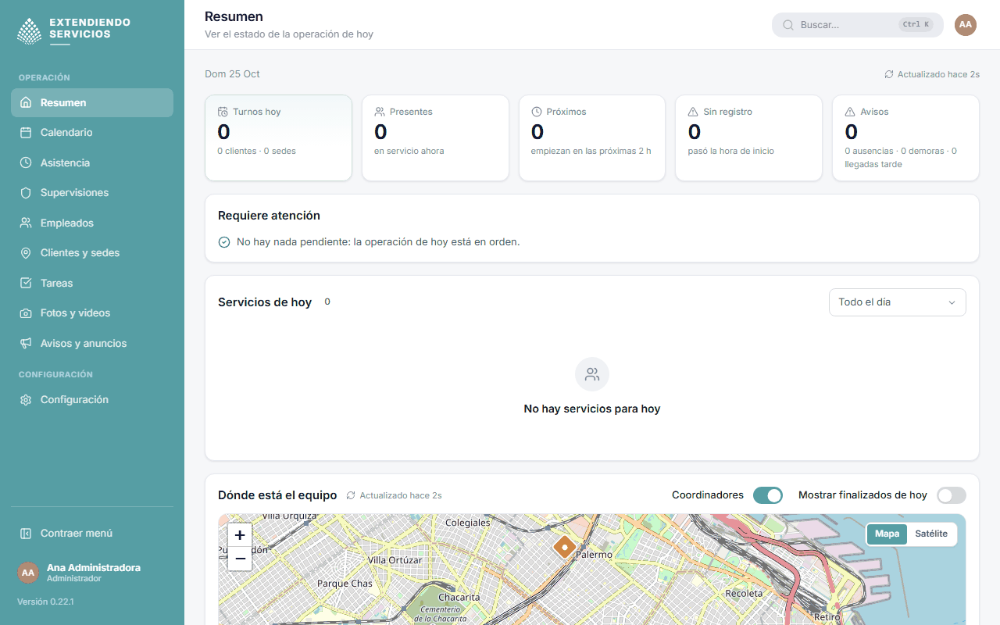

A la izquierda está el **menú**, con nueve secciones:

| Sección              | Para qué sirve                                                                |
| -------------------- | ----------------------------------------------------------------------------- |
| **Resumen**          | Cómo viene el día de hoy y qué requiere atención                              |
| **Calendario**       | El cronograma por mes, semana y día; crear y generar turnos                   |
| **Asistencia**       | Quién llegó, quién avisó y quién no registró; la jornada de los coordinadores |
| **Supervisiones**    | Consultar supervisiones y calificaciones                                      |
| **Empleados**        | La dotación: empleados y coordinadores                                        |
| **Clientes y sedes** | Clientes, sus sedes, contactos y servicios                                    |
| **Tareas**           | Las listas de tareas de cada cliente y de cada sede                           |
| **Insumos**          | El stock de insumos, los retiros, los avisos de faltante y los controles      |
| **Configuración**    | Usuarios y roles, datos de la empresa, feriados, criterios, seguridad         |

Arriba hay un **buscador** (también se abre con las teclas `Ctrl` y `K`) y tu foto, que abre el menú con **Mi perfil** y **Cerrar sesión**. Abajo del menú ves tu nombre, tu rol y la versión de la plataforma.

Las listas que se miran en vivo (Resumen, Asistencia, Calendario del día) se **actualizan solas** cada 30 segundos; dicen "Actualizado hace n s". No hace falta recargar.

---

## Puesta en marcha: en qué orden cargar todo

Si empezás desde cero (o querés revisar que no falte nada), este es el orden que evita volver para atrás:

1. **Empresa** (solo dueño): logo, nombre, teléfono de soporte y texto de consentimiento de ubicación.
2. **Feriados** (solo dueño): cargar los del año.
3. **Criterios de calificación** (solo dueño): la guía que usan los coordinadores.
4. **Clientes**, con sus **contactos**.
5. **Sedes** de cada cliente (con ubicación en el mapa si querés verlas ahí).
6. **Tareas:** la lista de tareas de cada cliente (y de las sedes que necesiten una propia).
7. **Servicios** de cada sede: días de la semana, horario y dotación.
8. **Empleados y coordinadores**, con su usuario.
9. **Clientes y sedes preferenciales** de cada coordinador (opcional: solo ordena su lista).
10. **Generar los turnos del mes.**
11. **Asignar empleados** a cada turno. Los coordinadores no se asignan: eligen ellos qué turno supervisar.

Si tenés mucha información para cargar de una vez (decenas de clientes o de empleados), no hace falta cargarla a mano: hay una planilla de Excel y un procedimiento de importación (`docs/carga-inicial.md`).

---

## Clientes y sedes

### Crear un cliente

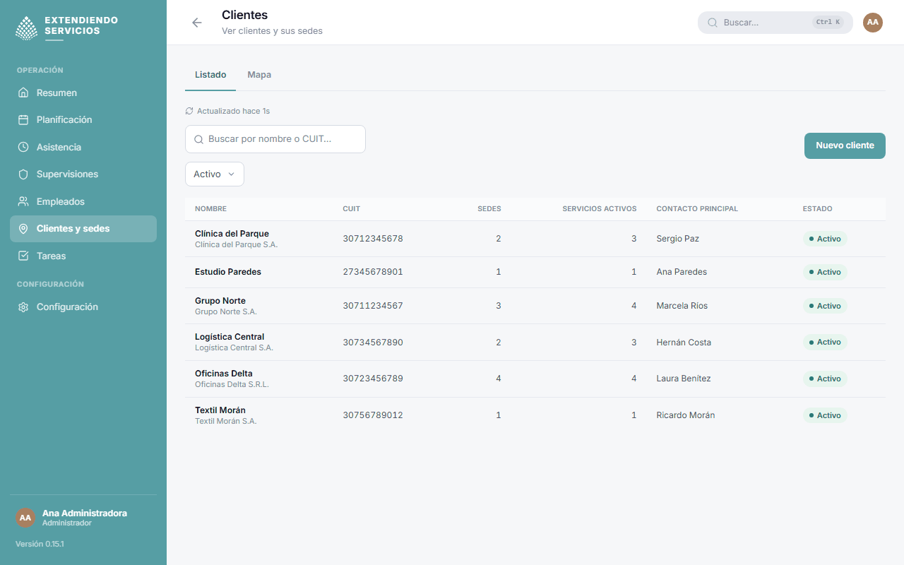

1. Entrá a **Clientes y sedes** y tocá **Nuevo cliente**.
2. Completá:
   - **Razón social** (obligatoria) y **Nombre de fantasía** (el que se muestra en las pantallas).
   - **CUIT** de 11 números, sin guiones.
   - **Estado:** **Activo**, **Suspendido** o **Baja**. Solo un cliente **Activo** admite turnos.
   - **Dirección administrativa** y **Notas**.
   - **Ubicación (opcional):** escribí la dirección en **Buscar dirección** y tocá el botón; el marcador cae en el mapa. Si no es el lugar exacto, movelo a mano.
3. Tocá **Crear cliente**.

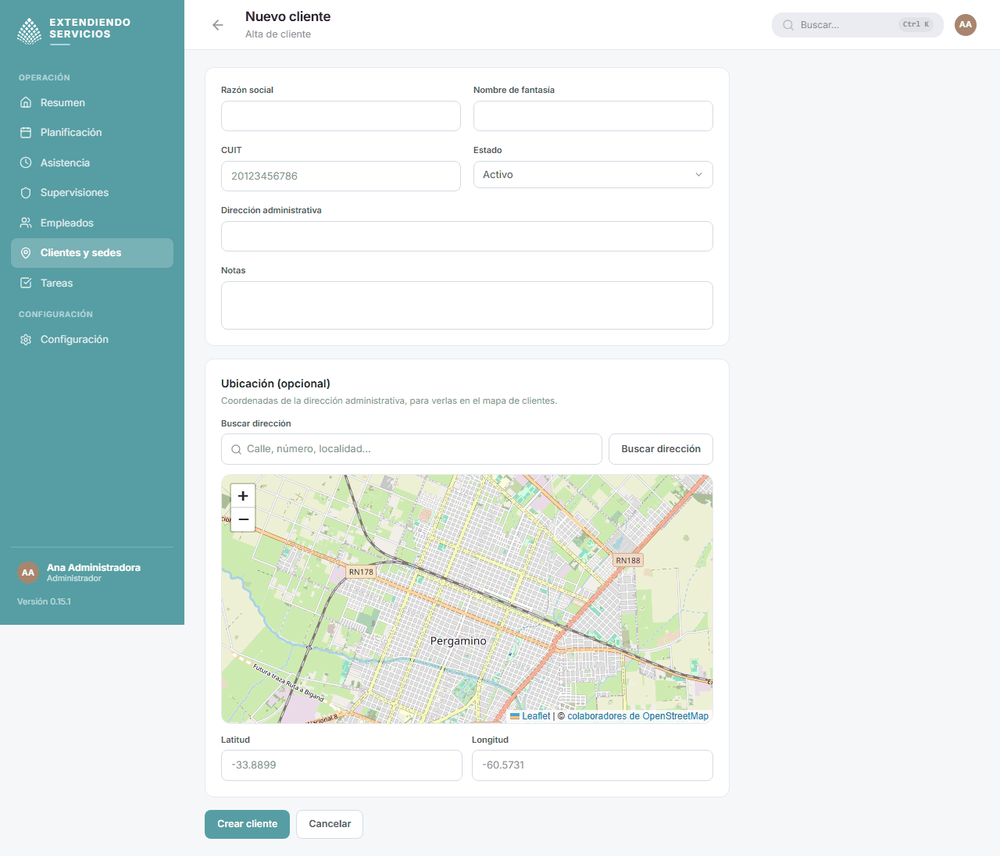

En el listado podés buscar por nombre o CUIT y filtrar por estado. Se ve cuántas sedes y cuántos servicios activos tiene cada cliente y quién es su contacto principal.

### La ficha del cliente

Tocá un cliente. Arriba ves sus datos, con **Cambiar estado** y **Editar**. Abajo hay cuatro pestañas. Además, en la ficha ves el bloque **Coordinadores preferenciales** (quiénes tienen a este cliente entre sus preferidos, ver [Coordinadores](#coordinadores-sedes-preferenciales-jornadas-y-correcciones)):

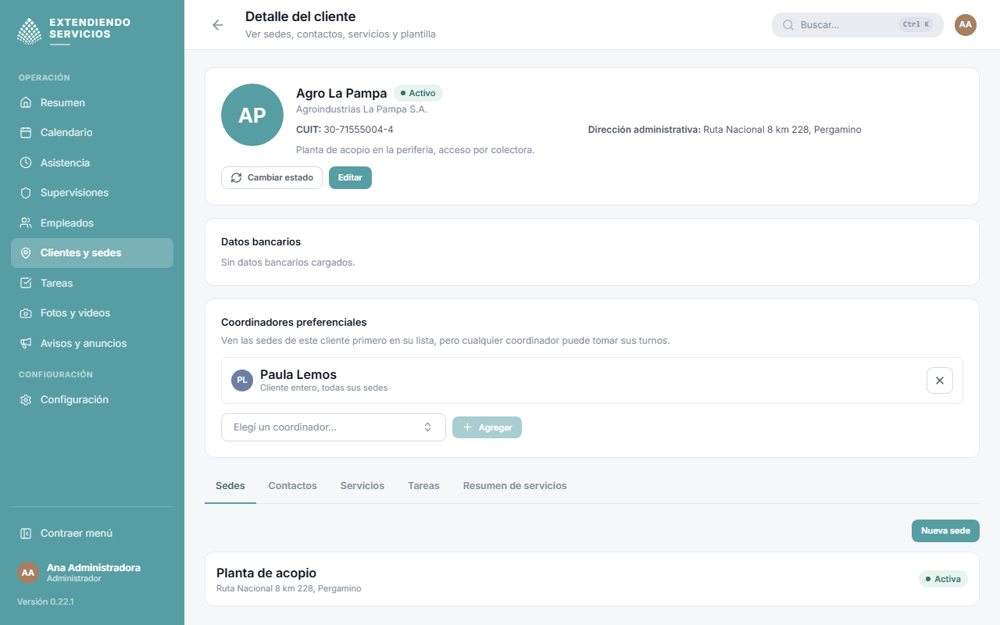

- **Sedes:** sus sedes, con el botón **Nueva sede**.
- **Contactos:** las personas de contacto. **Nuevo contacto** (nombre, cargo, teléfono, email). Podés marcar uno como **Principal**: es el que se ve en el listado.
- **Servicios:** todos los servicios del cliente, con **Nuevo servicio**.
- **Tareas:** la lista de tareas del cliente (ver [Tareas](#tareas-de-cada-servicio-plantillas)).

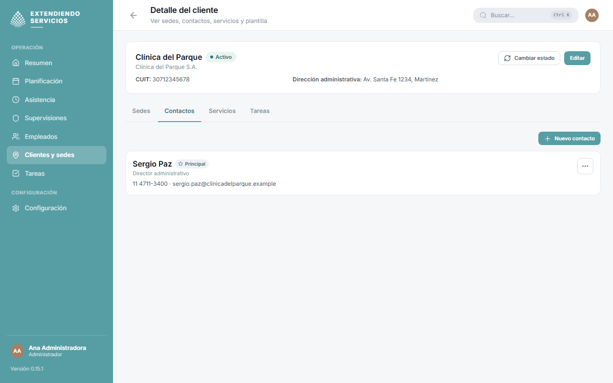

Para dejar de trabajar con un cliente, usá **Cambiar estado**: **Suspendido** si es temporal o **Baja** si es definitivo. No se borra nada: se conserva su historial.

### Crear una sede

1. En la ficha del cliente, pestaña **Sedes**, tocá **Nueva sede**.
2. Completá:
   - **Nombre**, **Estado** (**Activa** o **Inactiva**), **Dirección** y **Localidad**.
   - **Contacto en la sede** y **Teléfono de contacto**: lo ve el empleado en su celular para llamar.
   - **Horario del edificio**, por ejemplo "Lun a vie 7 a 20".
   - **Instrucciones de acceso:** por dónde entrar, a quién avisar.
   - **Restricciones informativas:** **No usar el teléfono en la sede**, **No se permiten fotos**, y **Otras restricciones**. Son avisos para el empleado, no bloquean nada.
   - **Ubicación (opcional):** **Buscar dirección** y ajustar el marcador, para que la sede aparezca en el mapa.
3. Tocá **Crear sede**.

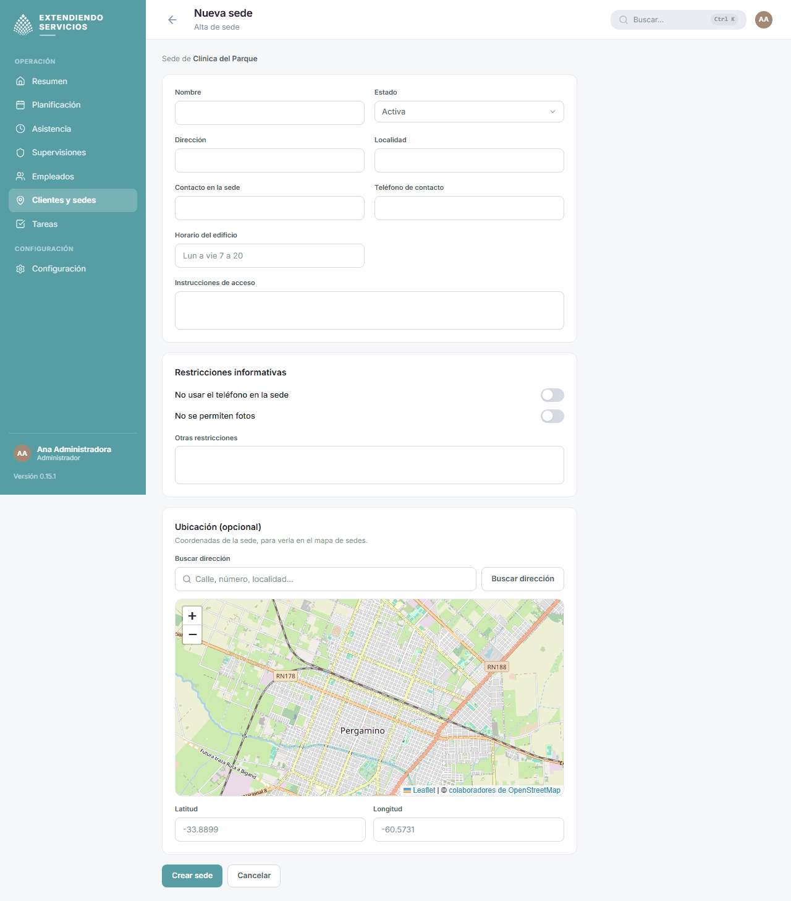

### La ficha de la sede

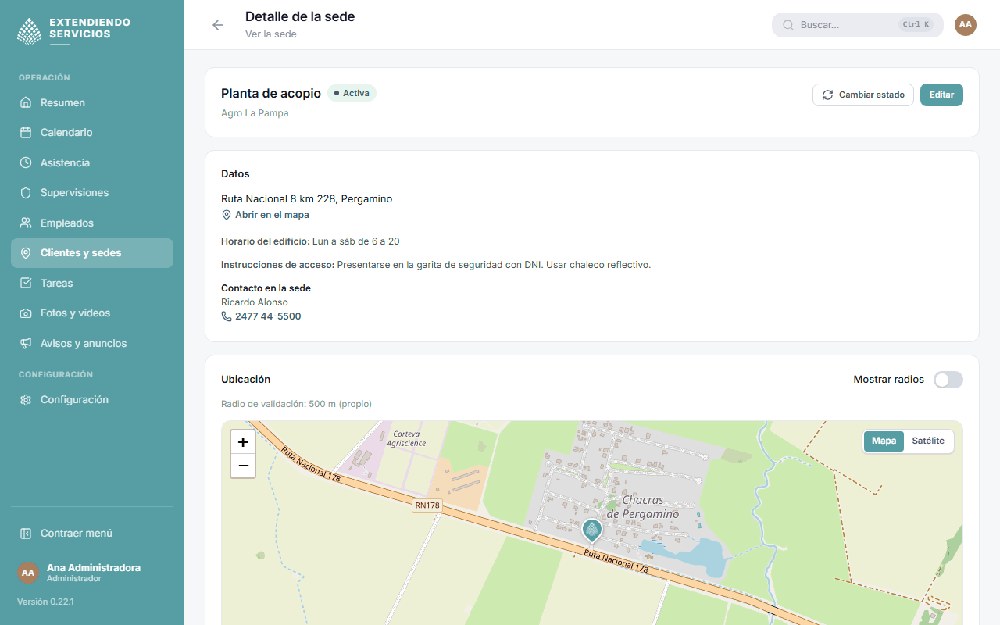

Muestra los datos, el mapa (si cargaste la ubicación), los **servicios** de la sede (con **Nuevo servicio**), la lista de tareas que usa, sus próximos turnos y el bloque **Coordinadores preferenciales** (los que la tienen como preferida, ya sea por la sede o por su cliente). Desde acá podés **Editar** o **Cambiar estado**.

### Ver todas las sedes en un mapa

En **Clientes y sedes**, la pestaña **Mapa** muestra todas las sedes que tienen ubicación cargada, con un color por estado. Tocá un marcador para ver el cliente, la dirección y los servicios activos. Podés filtrar por cliente. Arriba se indica cuántas sedes quedaron afuera por no tener ubicación.

---

## Tareas de cada servicio (plantillas)

Cada turno nace con una **lista de tareas** (por ejemplo "Barrer y trapear", "Limpiar baños"). Esa lista sale de una **plantilla**: una por cliente, y opcionalmente una propia para una sede que necesite otra cosa. Los empleados marcan esas tareas desde el celular.

**Permiso "Editar plantillas de tareas"** para crear o cambiar.

1. Entrá a **Tareas** y elegí el **Cliente**.
2. En **Ámbito** elegí **Plantilla del cliente**, o una sede: la sede usa la del cliente salvo que le crees una propia.

   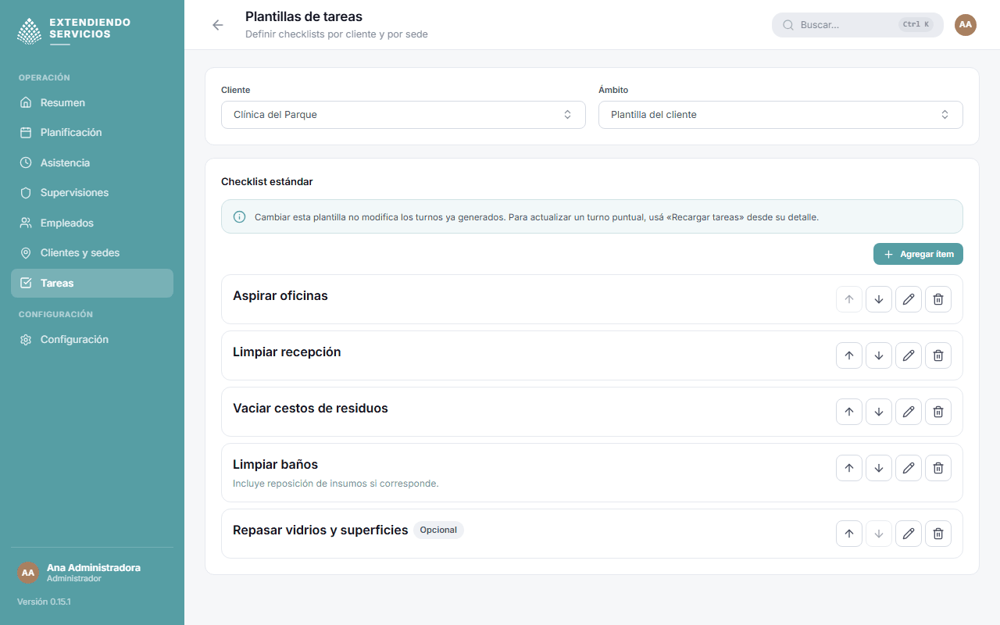

3. Tocá **Agregar ítem**, escribí el **título**, una **descripción** si hace falta, y marcá si es **obligatoria** u opcional. Guardá.
4. Con las **flechas** subís o bajás un ítem. Con el **lápiz** lo editás, con el **tacho** lo quitás.
5. Para que una sede tenga una lista propia, elegí la sede en **Ámbito** y creá su plantilla (parte de la del cliente, y la podés cambiar).

Dos cosas importantes:

- **Cambiar una plantilla no modifica los turnos que ya existen.** Los turnos nuevos nacen con la lista nueva. Para actualizar un turno que todavía no empezó, abrilo y tocá **Recargar tareas**.
- Las tareas **opcionales** no impiden terminar el servicio; las **obligatorias** que queden sin hacer solo generan un aviso al empleado.

---

## Servicios y turnos

Un **servicio** es un trabajo recurrente en una sede (por ejemplo "Limpieza mañana, de lunes a viernes de 6 a 10, con 2 personas"). Un **turno** es un día concreto de ese servicio. Primero se define el servicio, después se **generan los turnos** de cada mes.

### Crear un servicio

1. Entrá a la ficha del cliente o de la sede y tocá **Nuevo servicio**.
2. Completá:
   - **Cliente** y **Sede** (la sede se elige después del cliente).
   - **Nombre** (por ejemplo "Limpieza mañana"), **Estado** (**Activo**, **Pausado** o **Finalizado**: solo un servicio activo genera turnos) y **Dotación** (cuántas personas hacen falta, de 1 a 10).
   - **Días y franja horaria:** tildá los **días de la semana** y elegí **Desde** y **Hasta**. El horario no puede cruzar la medianoche.
   - **Trabaja los feriados:** si está apagado, ese servicio no genera turnos en los feriados.
   - **Pide fotos:** si está tildada, los turnos que se generen piden fotos. Quien limpia recibe un aviso si termina sin sacar ninguna (lo puede ignorar) y en el detalle del turno vas a ver la marca **Sin fotos**. Cambiarlo no modifica los turnos ya generados.
   - **Vigencia:** desde qué fecha rige y, opcionalmente, hasta cuándo.
   - **Horas mensuales (informativas)** y **Notas**: son datos de referencia.
3. Tocá **Crear servicio**.

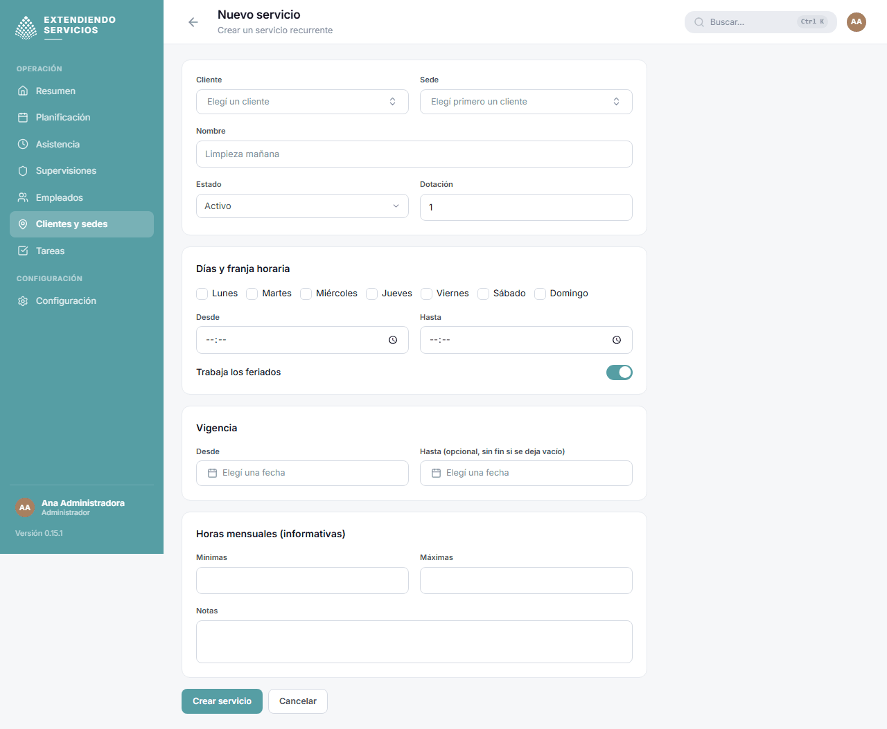

Si más adelante cambiás un servicio, **los turnos ya generados no cambian**: se aplica a los que generes después.

### Generar los turnos del mes

**Permiso "Generar turnos del mes".**

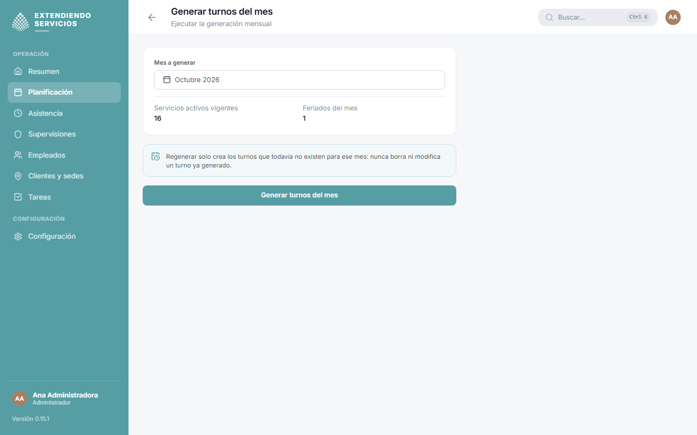

1. Entrá a **Calendario** y tocá **Generar turnos del mes** (o a la pantalla del mismo nombre).
2. Elegí el **Mes a generar**. Ves cuántos servicios activos vigentes hay y cuántos feriados tiene el mes.
3. Tocá **Generar turnos del mes**.
4. Al terminar, un mensaje dice cuántos turnos creó, cuántos omitió porque ya existían y cuántos porque caían en feriado.

Es seguro repetirlo: **solo crea los turnos que todavía no existen**; nunca borra ni modifica uno ya generado.

### Crear un turno puntual

Para un trabajo que no es recurrente (una limpieza especial, un reemplazo):

1. En **Calendario**, tocá **Nuevo turno**.
2. Elegí **Cliente**, **Sede**, **Fecha**, **Desde**, **Hasta** y **Dotación**. Podés agregar **Notas** y tildar **Pide fotos**.
3. Tocá **Crear turno**. Si la fecha es feriado, la pantalla te avisa.

Para cambiar **Pide fotos** en un turno que ya existe, usá **Editar franja** del detalle del turno.

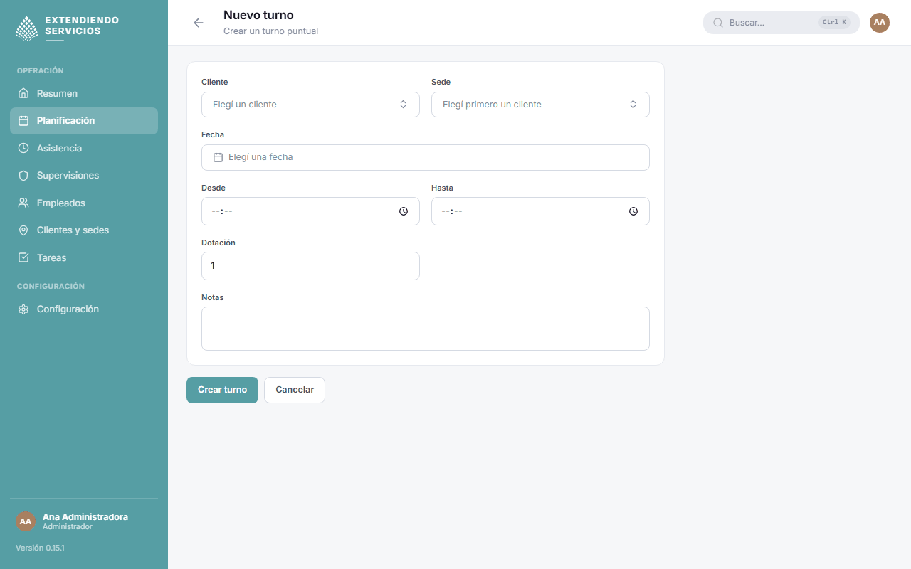

### Ver el cronograma

En **Calendario** hay tres vistas, con las pestañas **Mes**, **Semana** y **Día**.

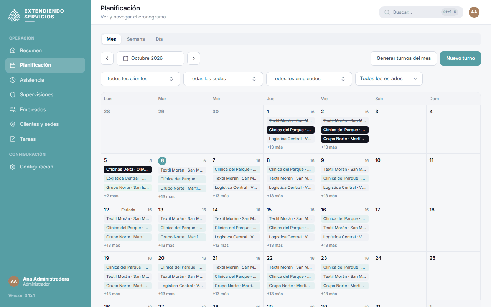

- **Mes:** un calendario con un chip por turno (cliente y sede), con el color del estado y los feriados marcados. Con las flechas o el selector cambiás de mes. Podés filtrar por cliente, sede, empleado y estado. En el celular se convierte en una lista de días.
- **Semana:** una grilla con cada empleado y sus servicios de la semana. Las celdas vacías dicen **Libre**. Sirve para ver la carga de cada persona.

  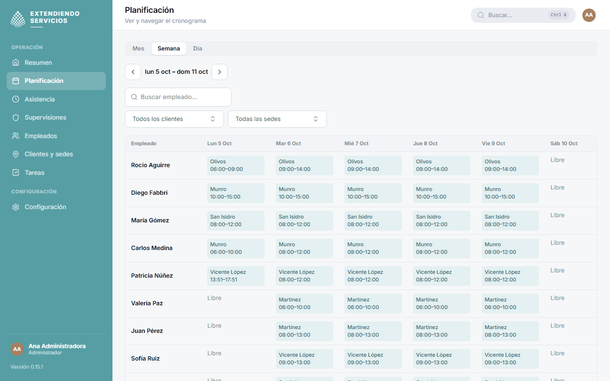

- **Día:** los turnos de una fecha, agrupados por franja horaria, con la **dotación** (asignados sobre requeridos), el estado y, si hubo, los **coordinadores que supervisaron** el turno. Con **Ver** abrís el turno, con **Editar** cambiás la franja, con **Cancelar** lo cancelás.

  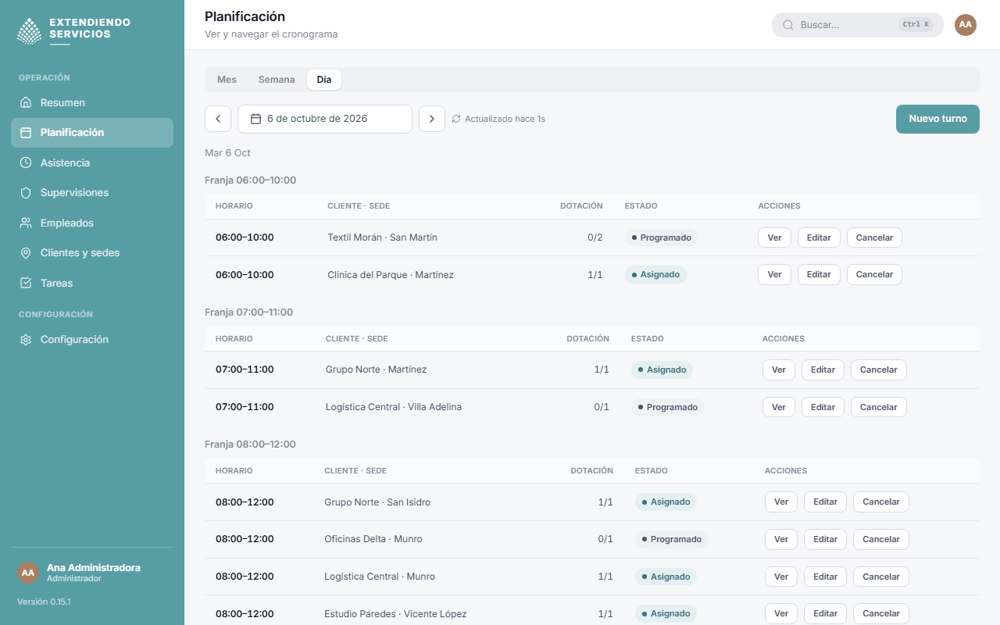

**Estados de un turno:** **Programado** (todavía sin personal), **Asignado**, **En curso**, **Finalizado** y **Cancelado**. Además, un turno aparece como **Sin cubrir** cuando le falta personal.

### El detalle de un turno

Abrí cualquier turno para ver y operar sobre él.

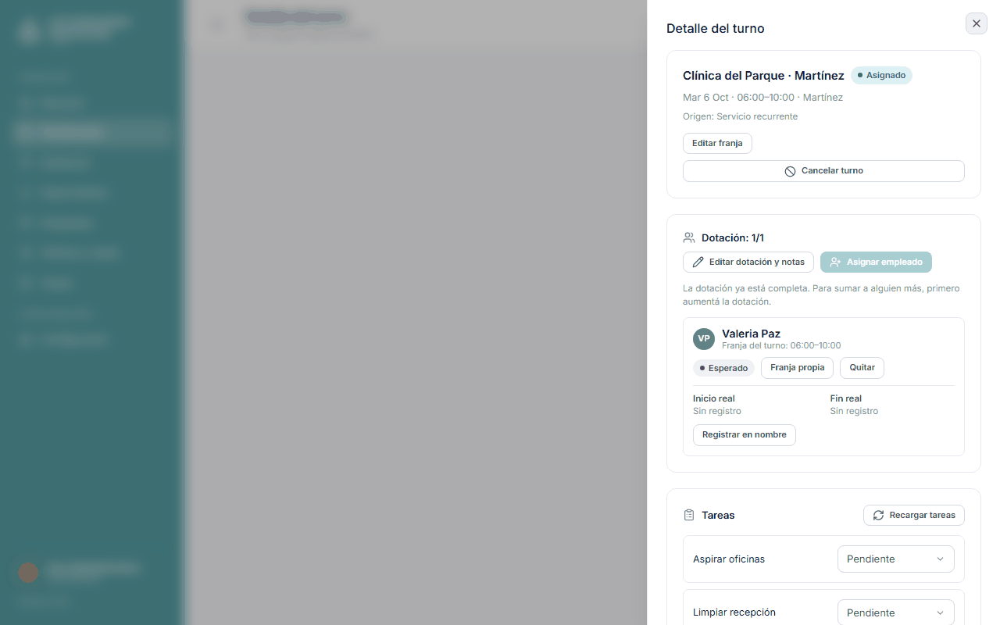

Ves el cliente y la sede, la fecha y la franja, el estado, y de dónde viene (servicio recurrente o turno puntual). Y estas secciones:

- **Dotación:** quiénes están asignados, con su estado, el inicio y el fin reales, los avisos y las observaciones que cargaron.
- **Tareas:** las tareas del turno y su estado.
- **Supervisiones:** los coordinadores que supervisan o supervisaron ese turno (puede haber más de uno), con el estado de cada supervisión.
- **Notas administrativas.**
- **Fotos y videos:** las miniaturas que subieron las personas del turno, agrupadas por persona. Si el turno **Pide fotos**, está en curso o finalizado y no hay ninguna foto, aparece la marca **Sin fotos**. Tocá una miniatura para abrir el visor (ver [Fotos y videos](#fotos-y-videos)).

Acciones: **Editar franja** (cambiar el horario del turno), **Editar dotación y notas**, **Cancelar turno** (pide un **Motivo de la cancelación**; **Permiso "Cancelar turnos"**), **Asignar empleado**, **Recargar tareas**. Ya no existe «Asignar coordinador» ni «Asignar supervisión»: los coordinadores toman el turno desde su celular.

Un turno que ya empezó solo permite cambiar la hora de fin. Un turno cancelado se conserva en el cronograma con su motivo.

---

## Asignar personal

Esta sección es para **empleados**. A los coordinadores no se los asigna a los turnos: ven todos los turnos del día y eligen (ver [Coordinadores](#coordinadores-sedes-preferenciales-jornadas-y-correcciones)).

1. Abrí el turno (desde **Calendario**, **Resumen** o **Asistencia**).
2. Tocá **Asignar empleado**. Se abre una lista con todas las personas activas y un buscador.

   Cada persona muestra etiquetas que te ayudan a decidir:

   | Etiqueta                            | Qué significa                                                               |
   | ----------------------------------- | --------------------------------------------------------------------------- |
   | **Habilitado y disponible** (verde) | Puede trabajar para ese cliente y está disponible en ese día y horario      |
   | **No habilitado para el cliente**   | Tiene restringidos otros clientes y este no está entre ellos                |
   | **Fuera de su disponibilidad**      | La franja no coincide con la disponibilidad que declaró                     |
   | **De licencia**                     | Tiene una licencia cargada para esa fecha                                   |
   | **Se superpone con …** (rojo)       | Ya está en otro turno que se pisa con este horario: **no se puede asignar** |
   | **También en …** (gris)             | Tiene otro turno ese día, en un horario que no choca                        |

3. Elegí a la persona. Si hace falta, indicá una **Franja propia (opcional)**: otro horario distinto del del turno, solo para ella.
4. Tocá **Asignar**.

Si la persona no está habilitada, está fuera de su disponibilidad o está de licencia, la plataforma **asigna igual y te avisa**: "Asignamos igual, con advertencias". Es un aviso para que decidas vos; si no era lo que querías, usá **Quitar**. En cambio, **una superposición de horarios se rechaza siempre**: "El empleado ya tiene otro turno en ese horario."

Otras acciones sobre una asignación, en el detalle del turno:

- **Franja propia:** cambiar el horario de esa persona.
- **Quitar:** sacar a la persona del turno (pide un motivo).
- Si el turno ya empezó, asignar o quitar requiere el **permiso "Registrar asistencia por otros"**.
- La **dotación** (cuántas personas hacen falta) se cambia con **Editar dotación y notas**.

---

## Empleados y coordinadores

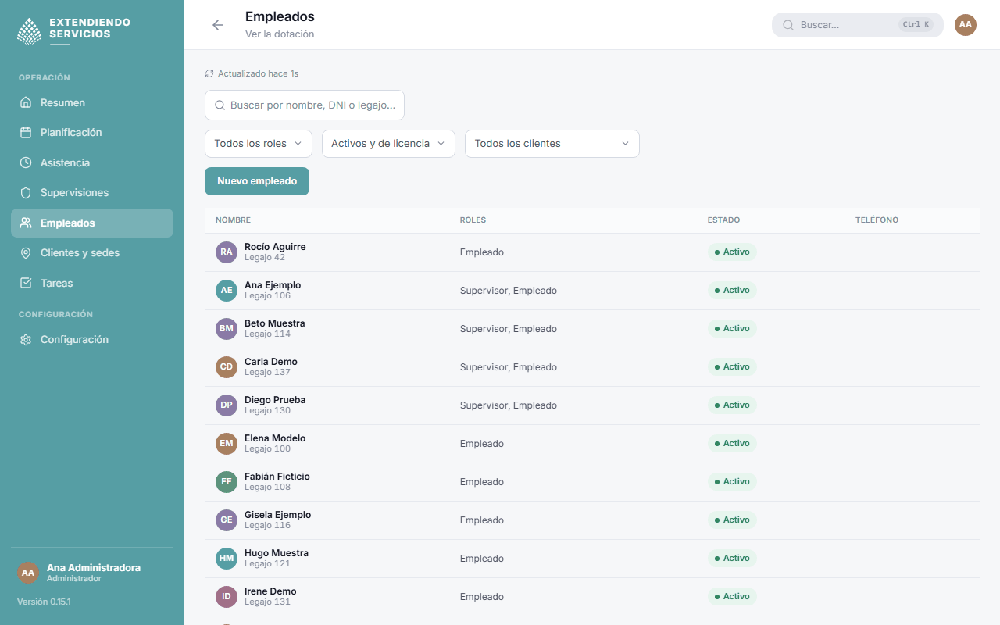

En **Empleados** ves a todo el personal, con su foto, nombre, legajo, roles, estado y teléfono. Se puede buscar por **nombre, DNI o legajo** y filtrar por **rol**, **estado** y **cliente habilitado**.

Un coordinador es una persona con el rol **Coordinador**. Una misma persona puede ser **empleado y coordinador** a la vez: en su celular ve las dos vías.

### Dar de alta un empleado o un coordinador

**Permiso "Gestionar usuarios".**

1. Tocá **Nuevo empleado**.
2. En **Roles** tildá **Empleado**, **Coordinador** o los dos.
3. En **Usuario y contraseña** completá el **Email de login** (con ese email la persona entra a la app) y una **Contraseña inicial** de al menos 8 caracteres. La persona la puede cambiar después desde su perfil. Pasale la contraseña por un **canal seguro**, nunca por un grupo.
4. En **Datos personales**: **Nombre**, **Apellido**, **DNI** (solo números), **CUIL** (11 números), **Teléfono**, **Fecha de nacimiento** y **Domicilio**.
5. En **Datos laborales**: **Legajo** (la plataforma sugiere el siguiente, lo podés cambiar), **Fecha de ingreso** y **Notas**.
6. En **Contacto de emergencia**: nombre, teléfono y vínculo.
7. Tocá **Crear**.

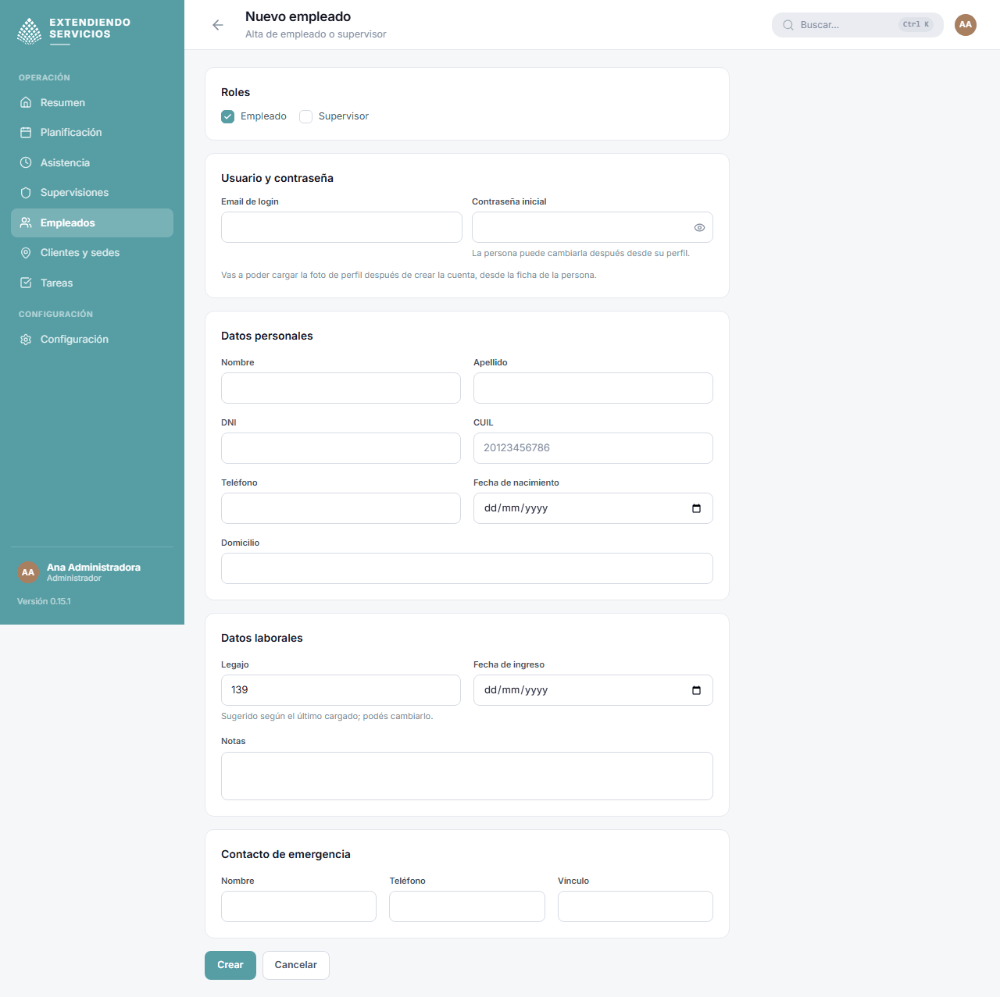

La foto de perfil se carga después, desde la ficha o desde el perfil de la propia persona.

### La ficha de la persona

Tocá a una persona para ver todo sobre ella.

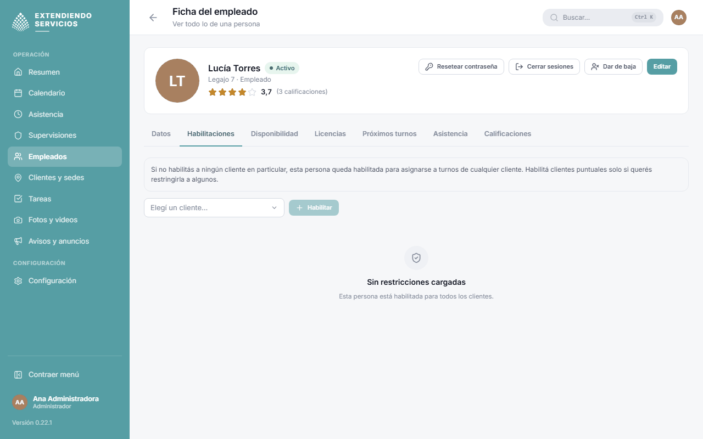

Arriba tenés las acciones: **Resetear contraseña**, **Cerrar sesiones**, **Dar de baja** y **Editar**. Abajo, las pestañas (los coordinadores tienen además **Clientes y sedes preferenciales** y **Jornadas**, ver [Coordinadores](#coordinadores-sedes-preferenciales-jornadas-y-correcciones)). También hay una pestaña **Retiros**, con los insumos que retiró la persona (ver [Los retiros de una persona](guia-insumos.md#los-retiros-de-una-persona)):

- **Datos:** datos personales, laborales, contacto de emergencia, usuario y roles (con **Editar roles**).
- **Habilitaciones:** a qué clientes puede ir la persona. **Si no habilitás a ningún cliente en particular, queda habilitada para todos.** Habilitá clientes puntuales solo si querés restringirla a algunos: elegí el cliente y tocá **Habilitar**.
- **Disponibilidad:** en qué días y horarios dice poder trabajar. Elegí el día y la franja y tocá **Agregar**. Es una guía: al asignar, la plataforma avisa si la franja no coincide, pero no lo impide.
- **Licencias:** períodos en que no trabaja (vacaciones, enfermedad). **Agregar licencia** con fecha de inicio y de fin. En el cronograma semanal la persona aparece atenuada y, al asignarla, se avisa.
- **Próximos turnos:** lo que tiene asignado. Con **Ver semana** abrís la grilla de esa persona.
- **Asistencia:** el historial de turnos pasados con inicio, fin, avisos y observaciones. Se puede cambiar el rango de fechas.
- **Calificaciones:** las que recibió de los coordinadores (solo lo ve Administración; el empleado no las ve). **Cada calificación se muestra por separado**, con quién la cargó: si dos coordinadores supervisaron el mismo turno, el empleado tiene dos calificaciones en esa tarea y no se promedian ni se agrupan.

### Resetear la contraseña, cerrar sesiones y dar de baja

**Permiso "Gestionar usuarios"** en los tres casos.

- **Resetear contraseña:** escribís una contraseña nueva y la pasás a la persona por un canal seguro.
- **Cerrar sesiones:** cierra la sesión de la persona en todos sus dispositivos (por ejemplo, si perdió el celular).
- **Dar de baja:** la persona **no puede iniciar sesión** y queda marcada como baja. **El historial se conserva** y nada se borra. Si tiene que volver, el **dueño** la reactiva (ver [Usuarios y roles](#usuarios-y-roles)).

---

## Coordinadores: sedes preferenciales, jornadas y correcciones

Desde la coordinación libre (P24) los coordinadores trabajan así:

1. **Nadie los asigna a los turnos.** Cada coordinador ve todos los turnos del día, de todos los clientes, y elige cuál supervisar.
2. **Cada uno tiene sus clientes y sedes preferenciales.** Le aparecen primero en su pantalla («Mis sedes»); el resto queda en «Otras sedes». Es solo un orden: puede tomar cualquier turno, y así se cubren las ausencias o demoras de otro coordinador.
3. **Cada uno lleva su jornada** desde el celular: **Iniciar jornada**, **Pausar**, **Reanudar** y **Finalizar jornada**. Sus horas son las de la jornada (de inicio a fin, menos las pausas, con los viajes entre sedes incluidos). El tiempo de cada supervisión es solo informativo y no suma horas.
4. **Dos o más coordinadores pueden supervisar el mismo turno**, y cada uno califica con su criterio.

Lo que hacés vos desde la oficina es cargar las preferencias, mirar las jornadas y, si hace falta, corregirlas.

### Clientes y sedes preferenciales

**Permiso "Gestionar supervisiones".** Una preferencia puede ser de un **cliente entero** (cubre todas sus sedes, también las que se creen después) o de **una sede**. Una sede puede tener varios coordinadores preferenciales. No hay límite ni obligación: un coordinador puede no tener ninguna.

**Desde la ficha del coordinador:**

1. Entrá a **Empleados** y abrí la ficha del coordinador.
2. Abrí la pestaña **Clientes y sedes preferenciales**.

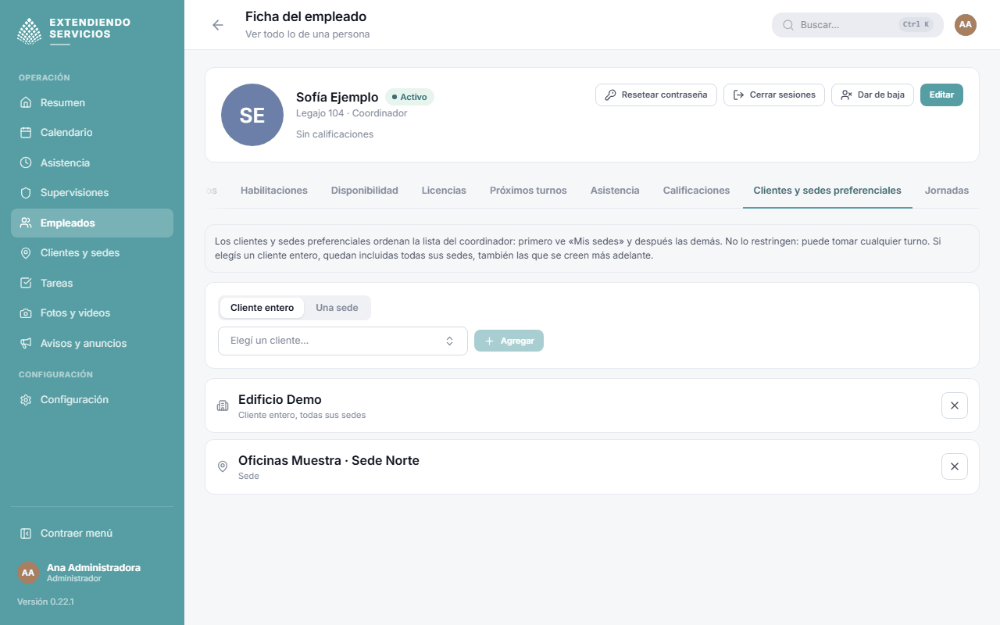

3. Elegí **Cliente entero** o **Una sede**, buscá el cliente o la sede en la lista y tocá **Agregar**. Aparece abajo, con un aviso de confirmación.
4. Para sacar una, tocá la **X** al lado. No se borra nada: la preferencia queda dada de baja y se conserva el historial.

**Desde la ficha del cliente o de la sede:** en el bloque **Coordinadores preferenciales** podés agregar o quitar coordinadores de la misma manera: elegí el coordinador en **Elegí un coordinador…** y tocá **Agregar**, o la **X** para quitarlo.

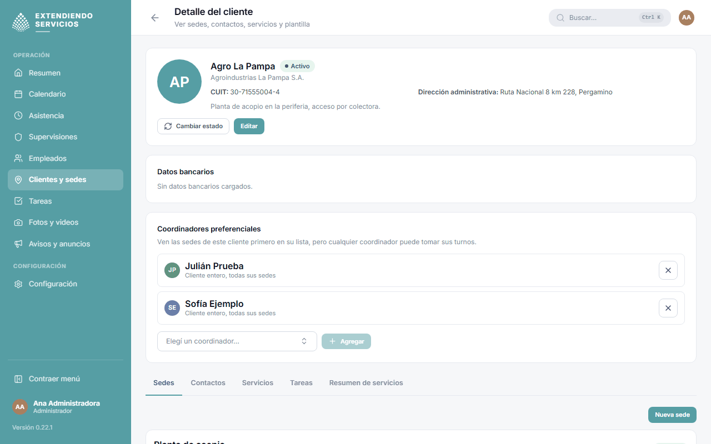

Si ya tenés los datos en la planilla de la carga inicial, la columna **Clientes y sedes preferenciales** de la hoja Supervisores los carga de una vez (ver [`carga-inicial.md`](carga-inicial.md)).

### Las jornadas de un coordinador

En la ficha del coordinador, la pestaña **Jornadas** muestra cada día con su detalle:

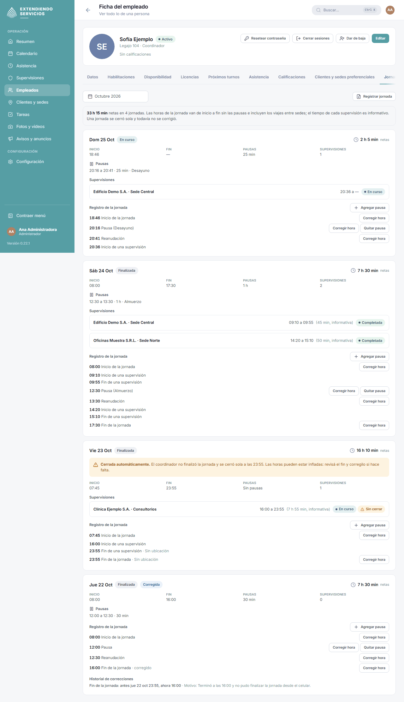

- La hora de **Inicio** y de **Fin**, y las **Pausas** con su motivo (si lo cargó).
- Las **horas netas** de la jornada.
- Las **Supervisiones** que hizo ese día, con su duración (informativa).
- El **Registro de la jornada**, evento por evento.
- Las marcas **Cerrada automáticamente** (la jornada se cerró sola, ver más abajo) y **Corregida** (la tocó Administración), y el **Historial de correcciones**.

Se cambia de mes con el selector de arriba a la izquierda.

Las **horas mensuales** de los coordinadores se cuentan igual que las de los empleados, **sin topes ni avisos** de rango.

### Cierre automático y la marca «Sin cerrar»

Si un coordinador no finaliza su jornada, la plataforma la **cierra sola a las 23:55** (hora de Argentina), antes de la medianoche, y la marca **Cerrada automáticamente** con una advertencia. Si ese coordinador tenía una supervisión abierta, se registra su fin a las 23:55 y queda con la marca **Sin cerrar**; Administración recibe el aviso.

Dónde lo ves:

- En **Resumen**, el bloque de supervisiones del día muestra las jornadas abiertas y las cerradas automáticamente.
- En **Supervisiones**, la marca **Sin cerrar** en la fila (ver más abajo la captura de la lista).
- En la pestaña **Jornadas**, la marca **Cerrada automáticamente**.

Conviene que la empresa explique en la capacitación que **hay que finalizar la jornada a mano**: si el coordinador terminó a las 18:00 y no finalizó, el cierre automático le suma horas hasta las 23:55.

### Corregir una jornada

**Permiso "Registrar asistencia por otros".** Podés corregir cualquier horario de la jornada: la hora de inicio o de fin, y agregar o quitar pausas. **El motivo es obligatorio** y queda registrado quién lo hizo, cuándo, por qué y el valor anterior.

1. En la ficha del coordinador, abrí la pestaña **Jornadas** y elegí el día.
2. En el **Registro de la jornada**, tocá **Corregir hora** al lado del horario que querés cambiar.

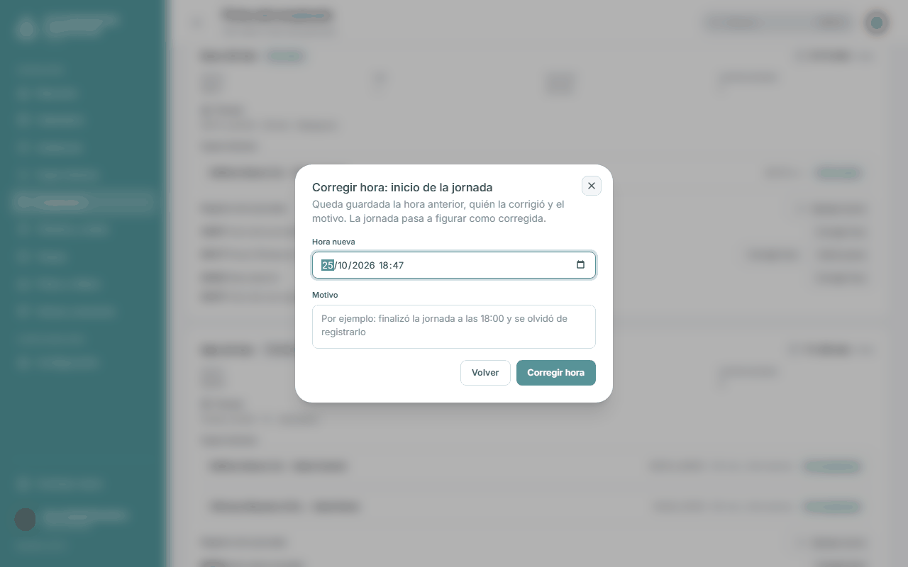

3. Escribí la **Hora nueva** (tiene que ser del mismo día y no futura) y el **Motivo**.
4. Confirmá. La jornada pasa a mostrar la marca **Corregida**.

Para las pausas, usá **Agregar pausa** (**Desde** y **Hasta** qué hora, con el motivo de la pausa y el motivo de la corrección) o **Quitar pausa** en una pausa que no corresponde.

Si el coordinador **se olvidó de iniciar la jornada** de un día, tocá **Registrar jornada** (arriba a la derecha de la pestaña): **Inicio**, **Fin** y **Motivo**. Solo se puede si ese día no tiene jornada.

Una corrección **quita la advertencia** del cierre automático y deja la constancia de que la hubo. Los horarios de inicio y fin de cada supervisión no se corrigen desde acá.

### La ficha imprimible

Igual que la de los empleados, es el **registro en papel de la jornada** del coordinador.

> **Aviso: períodos anteriores a la versión 0.23.0.** Antes de que existieran las jornadas, el coordinador figura con **0 horas** en la asistencia, en el **Resumen** y en esta ficha imprimible. Es a propósito: las supervisiones viejas ya no suman horas, ahora solo cuentan las jornadas (de inicio a fin, menos las pausas). No se perdió ningún dato; el tiempo de cada supervisión sigue visible como dato informativo.

1. En la ficha del coordinador, abrí la pestaña **Asistencia** y elegí el período con **Desde** y **Hasta**.
2. Tocá **Descargar detalle**. Se abre la vista previa.

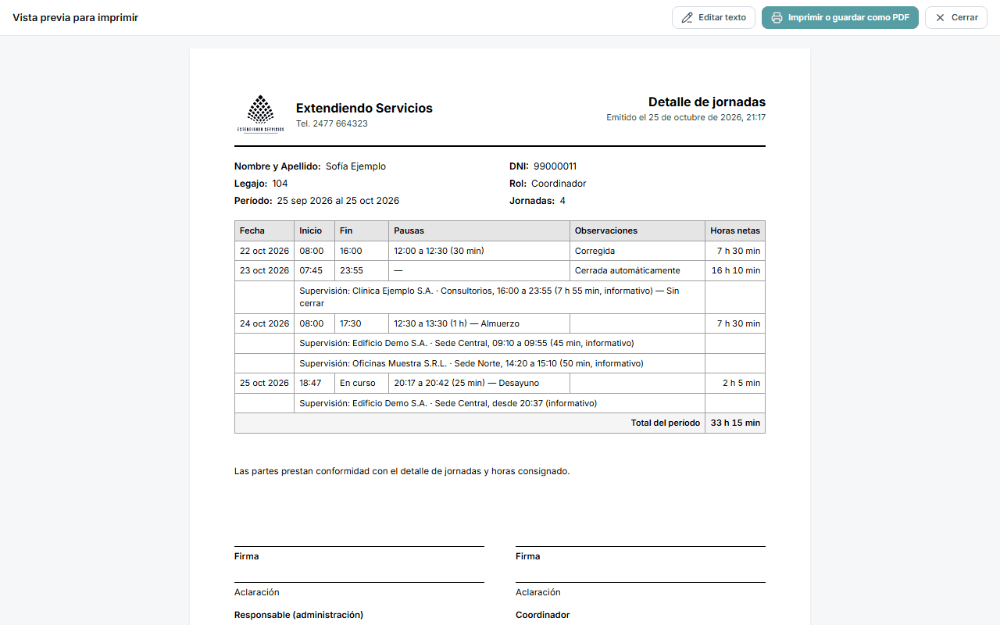

3. Revisá la hoja. Como las demás hojas imprimibles, podés **Editar texto** y después **Imprimir o guardar como PDF**. **Cerrar** vuelve a la ficha.

Lleva el **detalle de cada jornada con sus supervisiones**, el **acumulado de horas del período** y el **pie de firmas** de consentimiento. Si la persona es **empleado y coordinador** a la vez, la ficha tiene dos secciones (los turnos como empleado y las jornadas como coordinador), cada una con su total, y al final la **suma**.

### El mapa de coordinadores

En **Resumen**, el mapa de presencia («Dónde está el equipo») suma a los coordinadores. Es una herramienta de **dueños y administradores**: los coordinadores no ven el mapa de los demás.

- Un punto por coordinador, en la **última posición conocida**, con un color por estado: **En actividad** (jornada iniciada, entre sedes), **Supervisando** (con cliente y sede), **En pausa** (con el motivo, si lo cargó), **Finalizada** y **Sin iniciar**.
- Con el interruptor **Coordinadores** (arriba a la derecha del mapa) mostrás u ocultás a los coordinadores.
- Al tocar un punto ves el estado, el cliente y la sede si está supervisando, la **hora del último registro**, las **horas de hoy** y **Ver jornada** (te lleva a la pestaña **Jornadas**).
- Si el último evento no trajo posición, el coordinador no tiene punto: figura debajo del mapa, en **Coordinadores sin ubicación**, con su estado.
- Se actualiza cada 60 segundos.

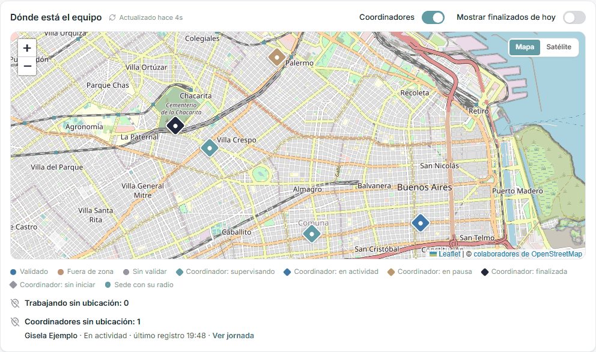

Debajo del mapa, el bloque **Supervisiones de hoy** muestra las **Jornadas abiertas** y las **Cerradas automáticamente**:

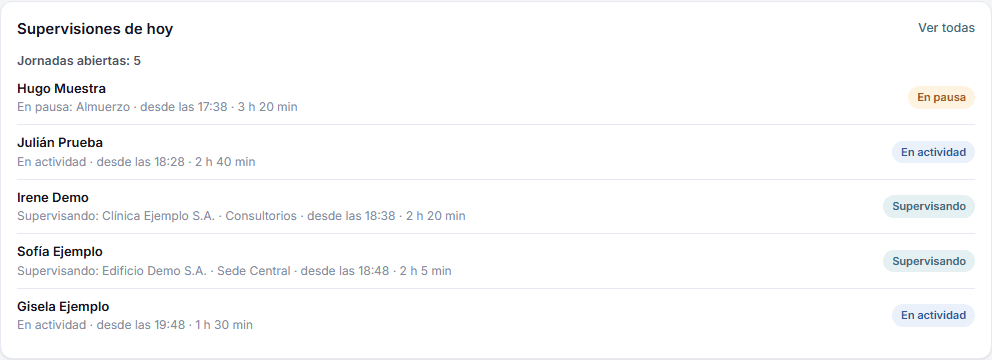

La posición se toma **solo en cada evento** (iniciar, pausar, reanudar y finalizar la jornada, y empezar y cerrar cada supervisión): no hay seguimiento continuo. Es **opcional y con consentimiento** del coordinador; la empresa decide si la exige.

---

## Seguir el día: Resumen y Asistencia

### Resumen

Es la pantalla de inicio. Muestra cómo viene el día de hoy:

- **Turnos hoy**, con cuántos clientes y sedes.
- **Presentes:** cuántas personas están en servicio ahora.
- **Próximos:** turnos que empiezan en las próximas 2 horas.
- **Sin registro:** personas cuya hora de inicio ya pasó y todavía no registraron.
- **Avisos:** ausencias y demoras avisadas.

Debajo de los números hay, además, dos tarjetas de insumos, **Faltantes avisados** y **Stock bajo** (ver [Insumos](guia-insumos.md#las-tarjetas-del-resumen)).

Debajo, **Requiere atención** junta lo que hay que resolver ahora. Si no hay nada, dice "No hay nada pendiente: la operación de hoy está en orden." Lo que aparece:

- Personas **sin registro** pasada la hora de inicio.
- Servicios **en curso pasada la hora de fin sin fin registrado**.
- Personas con **ausencia avisada**, con la opción de asignar un reemplazo.
- **Turnos sin cubrir.**

Y **Servicios de hoy**: una fila por persona con el cliente, la sede, el horario, el inicio real, el estado y la salida anticipada. Con el filtro **Todo el día** elegís una franja. Desde cada fila podés **Abrir turno** o **Registrar en nombre**.

**Un aviso que manda un empleado desde su celular aparece acá en menos de un minuto, sin recargar.**

Además, el **mapa de presencia** suma a los coordinadores y el bloque de supervisiones del día muestra las **jornadas abiertas** y las **cerradas automáticamente** (ver [El mapa de coordinadores](#el-mapa-de-coordinadores) y [Cierre automático y la marca «Sin cerrar»](#cierre-automático-y-la-marca-sin-cerrar)).

Arriba de los números puede aparecer un aviso amarillo o rojo: **el espacio de fotos y videos se está llenando** (desde el 70 %) o **está casi lleno** (desde el 90 %). Tocá **Ver fotos y videos** para ver qué ocupa lugar. Si no aparece, el espacio está bien.

### Asistencia de hoy

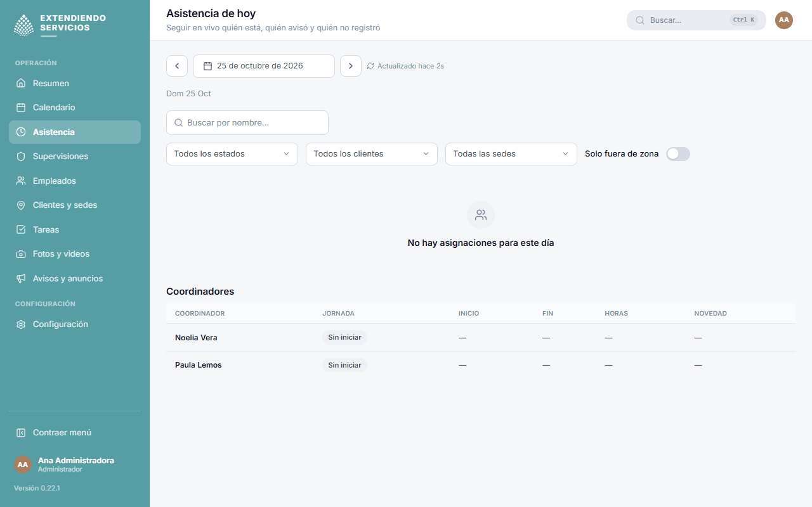

La lista completa del día, para seguir quién está. Cada fila muestra el empleado, el cliente y la sede, la franja, el **Inicio real**, el **Fin real**, el estado y la **Salida anticipada** (cuántos minutos).

Los **estados** son: **Esperado**, **Presente**, **Finalizado**, **Demora avisada** (con los minutos), **Ausencia avisada** (con el motivo) y **Sin registro**. "Sin registro" no lo marca nadie: aparece solo cuando pasó la hora de inicio y la persona no registró nada.

Podés filtrar por estado, cliente y sede, buscar por nombre y cambiar de fecha con las flechas o el calendario. Los días anteriores se ven en solo lectura. Acciones de cada fila: **Abrir turno**, **Registrar en nombre** y **Llamar** (si la persona tiene teléfono cargado).

Debajo, la sección **Coordinadores** muestra el estado de la jornada de cada uno: **Sin iniciar**, **En actividad**, **Supervisando**, **En pausa** o **Finalizada**, con la hora del último registro.

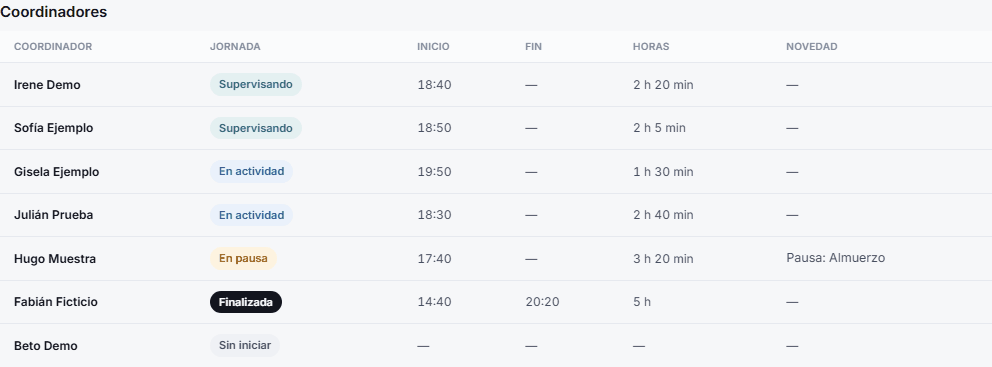

### Registrar en nombre de un empleado

**Permiso "Registrar asistencia por otros".** Sirve cuando una persona no puede usar la app (sin señal, sin batería, se olvidó) o avisa por teléfono.

1. En **Asistencia**, **Resumen** o el detalle del turno, tocá **Registrar en nombre**.
2. Elegí la **acción**: **Inicio**, **Fin**, **Cierre manual**, **Demora** o **Ausencia** (se ofrecen solo las que corresponden en ese momento).
3. Completá según la acción:
   - **Inicio, fin y cierre manual:** la **Hora** (por omisión, ahora; puede ser cualquiera desde las 00:00 del día del turno hasta ahora, **nunca una hora futura**) y el **Motivo**, que es obligatorio.
   - **Demora:** los minutos (de 1 a 600) y un motivo opcional.
   - **Ausencia:** el motivo de la lista (Enfermedad, Trámite, Problema personal, Problema de transporte, Otro) y, si es "Otro", el detalle. A diferencia del empleado, la administración puede registrar una ausencia **también después** de la hora de inicio.
4. Confirmá.

Queda anotado que lo cargó Administración y quién fue. El **cierre manual** sirve para cerrar un servicio que quedó sin fin registrado.

---

## Fotos y videos

Los empleados y coordinadores pueden subir **fotos y videos generales del turno** desde el celular (con la cámara o desde la galería). En el menú lateral, dentro de **Operación**, **Fotos y videos** (en el celular, dentro de **Más**) los ves todos. Es solo para el dueño y los administradores: cada empleado ve únicamente lo que subió.

### Cómo se usa la pantalla

- **Espacio usado** (arriba): cuánto ocupa todo lo guardado, sobre el tope de 1 GB del plan gratuito, con el detalle por tipo (fotos y videos de los turnos, fotos de perfil, logo, fotos de clientes). Está **amarillo desde el 70 %** y **rojo desde el 90 %**, y lo dice con palabras. La app no bloquea las subidas cuando se llena: avisa para que decidas a tiempo bajar los plazos o pasar a un plan pago.
- **Filtros:** rango de fechas (por defecto, los últimos 30 días), cliente, sede (primero elegí el cliente), persona, tipo (fotos y videos, solo fotos, solo videos) y **Todas / Conservadas / Por vencer en 7 días**. Al elegir **Conservadas** o **Por vencer** se vacía el rango de fechas, porque lo que está por vencer es más viejo que 30 días; podés volver a ponerlo.
- **Grilla:** las miniaturas agrupadas por turno, con el título **fecha · cliente · sede**. Tocá el título para abrir el detalle del turno. Se cargan de a 48: **Ver más** trae las siguientes.
- **Visor:** tocá una miniatura. Ves la foto o el video grande, quién lo subió, a qué hora y cuándo vence. Deslizá o usá las flechas para pasar al siguiente. Acciones: **Conservar** (o **Dejar de conservar**) y **Descargar**.
- **Descargar varias:** tildá las miniaturas (o **Seleccionar todo** en un turno) y tocá **Descargar ZIP**. Se arma en tu navegador, con nombres como `2026-10-13_ClienteX_SedeY_Nombre_01.jpg`, y muestra el avance; podés **Cancelar**. Hasta 50 archivos por ZIP.

### Cuándo vencen

Las fotos y los videos se **borran solos de noche** cuando pasa el plazo (60 días las fotos y 30 los videos, salvo que lo cambies en **Configuración → Empresa**). Del turno queda la **constancia**: la miniatura aparece como un cuadro gris que dice **Vencida**. Lo que marcás como **Conservar** no vence.

### Dónde más aparecen

- **Detalle del turno:** sección **Fotos y videos** con las miniaturas por persona, y la marca **Sin fotos** si el turno pide fotos, ya empezó y no hay ninguna.
- **Detalle de la supervisión:** las miniaturas que subió el coordinador.
- **Resumen:** el aviso de espacio, cuando pasa del 70 %.
- **Servicio y turno:** la casilla **Pide fotos**.
- **Eliminar un servicio:** no se puede si algún turno tiene fotos o videos (la pantalla lo explica como «fotos o videos»); dalo de baja.

---

## Supervisiones y calificaciones

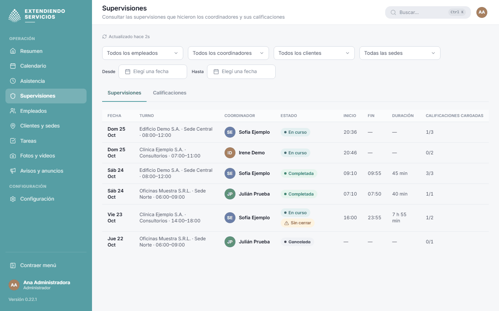

En **Supervisiones** consultás lo que hicieron los coordinadores. Ya no se asignan supervisiones: cada coordinador toma el turno que elige (ver [Coordinadores](#coordinadores-sedes-preferenciales-jornadas-y-correcciones)). La pantalla tiene dos pestañas:

- **Supervisiones:** una fila por supervisión, con la fecha, el turno (cliente, sede, franja), el coordinador, el estado (**En curso**, **Completada** o **Cancelada**), el inicio y el fin, la **duración** (informativa: no suma horas) y cuántas calificaciones se cargaron sobre el total de empleados. **Un mismo turno puede tener varias filas**, una por cada coordinador que lo supervisó.
- **Calificaciones:** una fila por empleado calificado, con la fecha, la sede, el coordinador, el puntaje y el comentario. Un empleado puede tener varias calificaciones en el mismo turno, una por coordinador.

Los filtros permiten buscar por empleado, coordinador, cliente, sede y rango de fechas (**Desde** y **Hasta**).

Marcas y estados que conviene conocer:

- **Sin cerrar** (marca amarilla junto al estado «En curso», ver la captura de arriba): la supervisión quedó abierta cuando se cerró la jornada del coordinador (a mano o por el cierre automático de las 23:55). Revisala: se registró un fin, pero el coordinador no la cerró ni calificó a todos.
- **Cancelada** con el motivo "Descartada por el coordinador": la empezó por error y la descartó. Con el motivo "Cambio de lógica de coordinación (23 oct 2026)" figuran las que estaban asignadas y sin empezar cuando cambió el funcionamiento.
- Las supervisiones anteriores al cambio pueden mostrar los estados viejos (**Asignada**, **No realizada**): son historial y no se modifican.

### Ver, cancelar o corregir una supervisión

Tocá una fila para abrir su detalle.

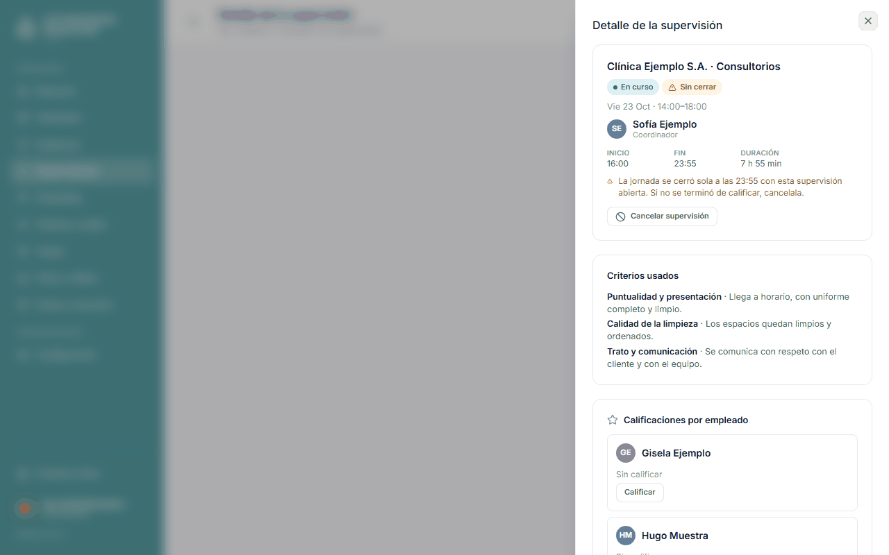

Ves el turno, el coordinador, el estado, el inicio, el fin y la duración, los **Criterios usados** y las **Calificaciones por empleado**, con el puntaje (de 1 a 5 estrellas), el comentario y quién lo editó y cuándo. Acciones:

- **Cancelar supervisión** (**Permiso "Gestionar supervisiones"**): pide el **Motivo de la cancelación**. Las calificaciones ya cargadas quedan registradas; solo cambia el estado. Es lo que corresponde para una supervisión **Sin cerrar**.
- **Calificar** o **Editar** una calificación (**Permiso "Editar calificaciones"**). El coordinador solo puede cambiar sus calificaciones mientras su supervisión está abierta; Administración puede hacerlo siempre, y queda anotado quién lo hizo.

---

## Insumos y control de stock

La sección **Insumos** lleva el stock de los productos de limpieza: el catálogo con fotos y precios, lo que entra al depósito, lo que retiran los empleados y los coordinadores desde el celular, los avisos de faltante y el control con planilla impresa. Tiene seis pestañas: **Stock**, **Movimientos**, **Faltantes**, **Consumo por cliente**, **Controles** y **Categorías**. Junto a **Insumos**, en el menú, aparece un número con los avisos de faltante abiertos.

Todo se explica paso a paso en su propia guía: **[Guía de Insumos para administración](guia-insumos.md)**. Lo más importante:

- Cargar el catálogo, los ingresos, los ajustes, los retiros en nombre de otra persona, los controles y las anulaciones necesita el **permiso "Gestionar stock"** (el dueño lo tiene siempre). Sin el permiso, el administrador **mira todo** y puede **resolver avisos de faltante**.
- Los retiros **descuentan el stock en el momento**; no hay aprobación. Si hay un error, se corrige con **Anular** (con motivo) o con un **ajuste**.
- El **Resumen** suma dos tarjetas: **Faltantes avisados** y **Stock bajo**.

---

## Configuración

Reúne cinco pantallas, con pestañas arriba: **Usuarios**, **Empresa**, **Feriados**, **Criterios de calificación** y **Eventos de seguridad**. El administrador solo ve **Usuarios** y **Empresa**.

### Usuarios y roles

Lista a todas las personas con acceso, con su rol y su estado (**Activo** o desactivado). Por omisión muestra solo las activas: activá **Mostrar desactivados** para ver también las demás. **Solo dueño:** la columna **Último ingreso**.

En la fila de cada persona, el botón de los tres puntos abre las acciones:

| Acción                          | Quién la hace                                                                                    |
| ------------------------------- | ------------------------------------------------------------------------------------------------ |
| **Resetear contraseña**         | Dueño; administrador con **permiso "Gestionar usuarios"** (solo sobre empleados y coordinadores) |
| **Cambiar email**               | Ídem                                                                                             |
| **Cerrar sesiones**             | Ídem                                                                                             |
| **Desactivar** (pide un motivo) | Ídem                                                                                             |
| **Reactivar**                   | **Solo dueño**                                                                                   |
| **Editar roles y capacidades**  | **Solo dueño**                                                                                   |

**Solo dueño: nuevo administrador.** Con **Nuevo administrador** completás nombre, apellido, **Email de login** y una **Contraseña inicial**, igual que para un empleado.

**Solo dueño: dar permisos a un administrador.** En el menú de la persona, **Editar roles y capacidades**. Ahí se tildan los ocho permisos (**Gestionar usuarios**, **Cancelar turnos**, **Editar calificaciones**, **Editar plantillas de tareas**, **Registrar asistencia por otros**, **Generar turnos del mes**, **Gestionar supervisiones** y **Gestionar stock**). Los permisos **se guardan solos** al activarlos. Los roles se guardan con **Guardar roles**; si al guardar le sacás un rol a alguien, se le cierran las sesiones.

### Empresa

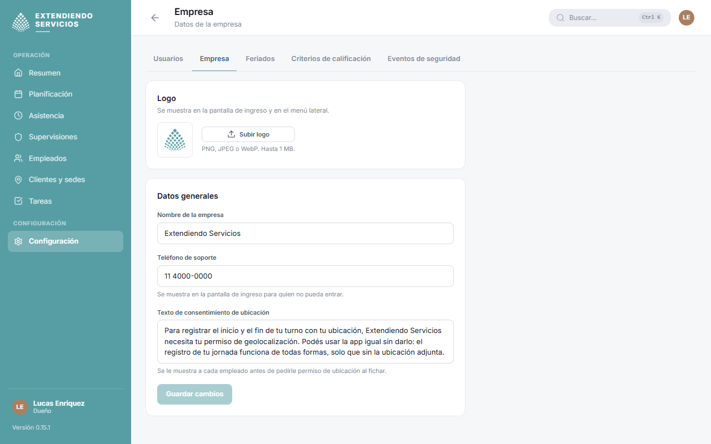

- **Logo:** **Subir logo** (PNG, JPEG o WebP, hasta 1 MB). Se ve en la pantalla de ingreso y en el menú. **Lo pueden cambiar el dueño y los administradores.**
- **Solo dueño:** **Nombre de la empresa**, **Teléfono de soporte** (aparece en la pantalla de ingreso, para quien no pueda entrar) y **Texto de consentimiento de ubicación** (lo lee cada empleado antes de dar su permiso). Se guardan con **Guardar cambios**.
- **Fotos y videos** (dueño y administradores): cuántos días se guardan las **fotos** (60 por defecto) y los **videos** (30 por defecto), de 7 a 365 días. Se guardan con **Guardar plazos**. Un plazo nuevo vale también para lo que ya está guardado. Lo que marcaste como **Conservar** no vence nunca. Abajo ves cuánto espacio se usa.

### Feriados (solo dueño)

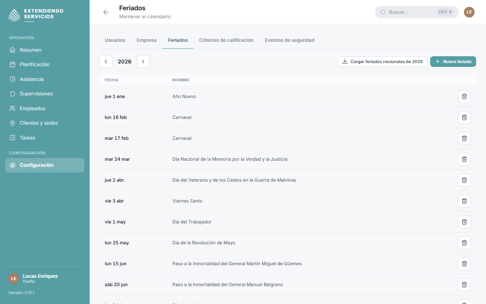

El calendario de feriados, por año. Con **Cargar feriados nacionales de <año>** se agregan de una vez los nacionales; con **Nuevo feriado** sumás uno propio (por ejemplo un feriado local). Los feriados tienen dos efectos: se marcan en el cronograma, y **los servicios que tienen apagado "Trabaja los feriados" no generan turnos esos días**.

### Criterios de calificación (solo dueño)

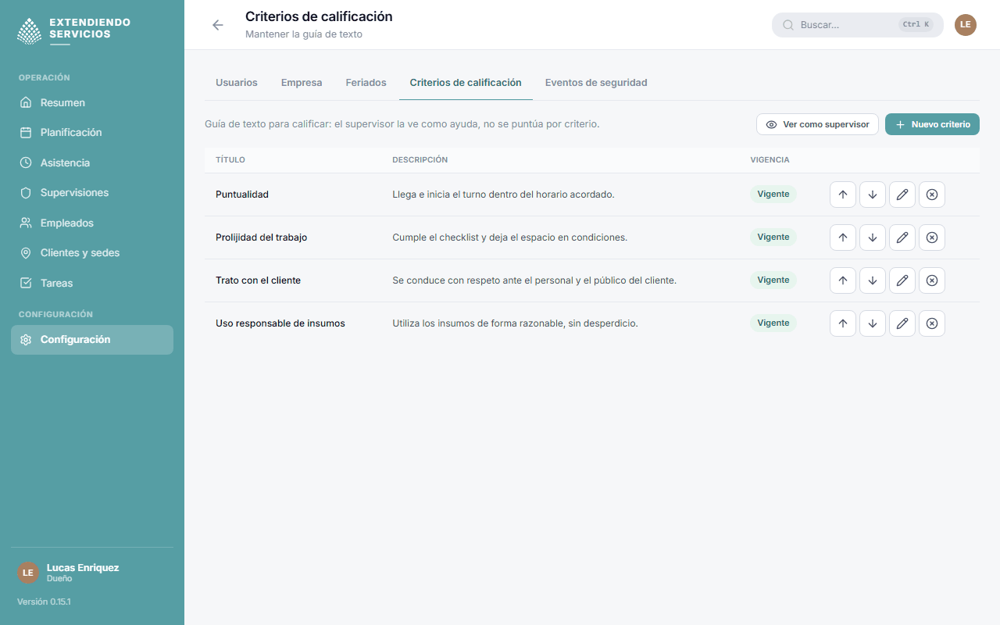

La guía de texto que ven los coordinadores cuando califican (por ejemplo "Puntualidad", "Calidad de la limpieza"). **No se les pone puntaje a cada criterio**: el puntaje es uno solo por empleado, de 1 a 5. Con **Nuevo criterio** agregás uno (**Título** y **Descripción**) y lo guardás con **Agregar criterio**; empieza a regir desde ese momento. Para dejar de usar uno, **Cerrar criterio**: las supervisiones que ya empezaron conservan los criterios con los que se hicieron.

### Eventos de seguridad (solo dueño)

Una tabla de consulta con los inicios de sesión y los cambios de acceso (altas, bajas, cambios de roles, resets de contraseña): fecha y hora, qué pasó, quién lo hizo y sobre quién. Se puede filtrar por tipo de evento, persona y fechas. Sirve para revisar quién hizo qué.

---

## Usar la administración desde el celular

La administración se adapta a tablet y celular. En el celular, el menú pasa a una barra de abajo con cinco botones: **Hoy**, **Calendario**, **Asistencia**, **Supervisiones** y **Más** (donde está el resto: empleados, clientes y sedes, tareas, insumos y configuración).

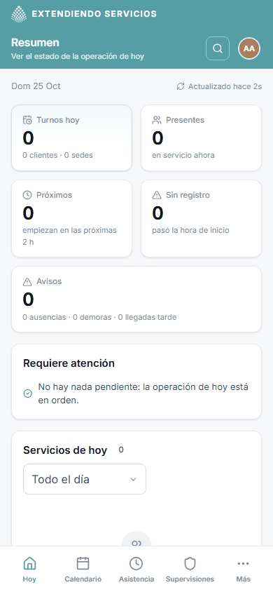

Las tablas se ven como tarjetas, y los paneles ocupan toda la pantalla. Desde el celular podés hacer lo mismo que en la computadora; lo más útil: ver el **Resumen** y el mapa, **asignar un empleado** a un turno y **registrar en nombre** de otra persona.

---

## Lo que no incluye la Plataforma Base

Para evitar malentendidos: las siguientes funciones **no existen** en esta versión. Si las necesitan, se cotizan como ampliación (módulos previstos en el acuerdo):

- **Fotos** como evidencia de tareas o de supervisiones.
- **Notificaciones al celular** (avisos al empleado cuando se le asigna un turno, recordatorios). Hoy el empleado ve sus cambios al abrir la app, en **Cambios desde tu última visita**.
- Cálculo de **horas, puntualidad y reportes** por empleado o cliente, y **exportaciones** (la única excepción es el Excel de Movimientos y de Consumo por cliente de la sección Insumos).
- Funcionamiento **sin conexión** con sincronización posterior.
- **Seguimiento continuo de la ubicación** de empleados y coordinadores: la posición se toma solo en cada evento (inicio, pausa, reanudación y fin), nunca de forma permanente.

Los **insumos** (stock, movimientos, avisos de faltante y controles) sí existen desde la versión 0.25.0: se explican en la [guía de Insumos](guia-insumos.md). Lo que **no** incluye esa sección: herramientas o equipos que se devuelven (hoy el stock es de consumibles), pedidos de reposición (hay avisos de faltante) y retiros sin conexión.

---

## Cuando algo no anda

Todos los problemas frecuentes, con su causa y su solución, están en [`troubleshooting.md`](troubleshooting.md). Los más comunes para administración:

- [No me aparece un botón](troubleshooting.md#71-no-me-aparece-un-botón-por-ejemplo-cancelar-turno-o-generar-turnos-del-mes): falta un permiso que da el dueño.
- [Creé un servicio y no aparecen los turnos](troubleshooting.md#75-creé-un-servicio-pero-no-aparecen-los-turnos): hay que generarlos.
- [No puedo asignar a una persona](troubleshooting.md#73-el-empleado-ya-tiene-otro-turno-en-ese-horario): superposición de horarios.
- [Una persona no puede entrar](troubleshooting.md#1-ingreso-y-sesión): reseteo de contraseña, reactivación.
