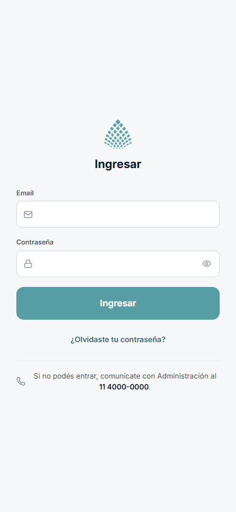
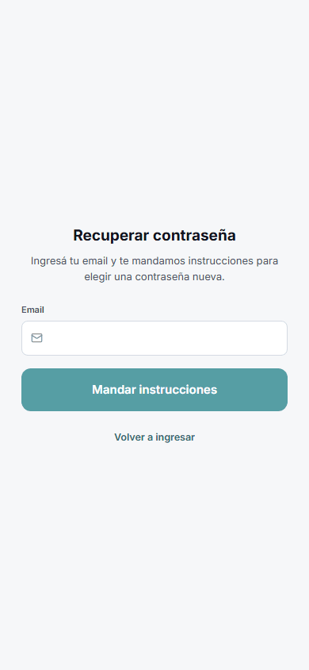
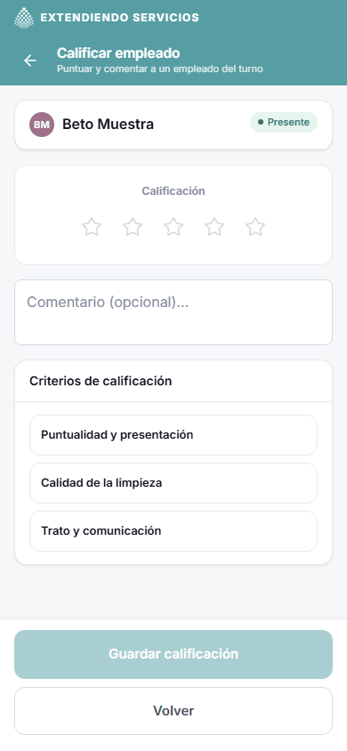
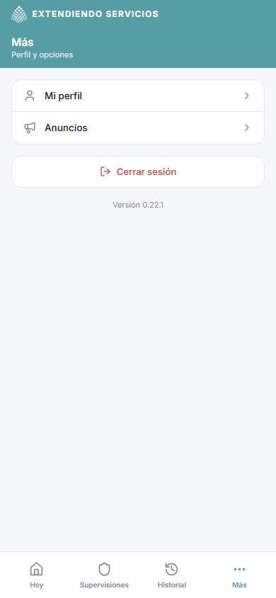

# Guía del coordinador

DOC-020, actualizada con P24.6 (coordinación libre y jornada). Cómo usar la aplicación de Extendiendo Servicios desde tu celular si sos coordinador o coordinadora: iniciar tu jornada, elegir qué turno supervisar, calificar a cada empleado, cerrar la supervisión y finalizar el día.

Las imágenes son de ejemplo, con datos inventados. Los nombres de los botones son los mismos que vas a ver en tu celular. Donde dice **(captura pendiente)** todavía falta la imagen de la pantalla nueva.

## Cómo funciona, en pocas palabras

1. **Nadie te asigna supervisiones.** Ves todos los turnos del día, de todos los clientes, y elegís cuál supervisar.
2. **Primero iniciás tu jornada.** Es tu horario de trabajo: desde que empezás hasta que terminás, menos las pausas.
3. **Tus sedes aparecen primero.** Son las que Administración marcó como tuyas. Pero podés tomar cualquier turno: así se cubren las ausencias o demoras de otro coordinador.
4. **Tocás Supervisar**, calificás a todos los empleados del turno y cerrás la supervisión.
5. **Al terminar el día, finalizás tu jornada.**

## Qué necesitás

- Un celular con **Chrome** (Android 8 o más nuevo) o **Safari** (iPhone con iOS 16.4 o más nuevo).
- Tu **email** y tu **contraseña**, que te da Administración.
- La dirección de la aplicación, que también te pasa Administración.

Si ves un cartel amarillo arriba que dice "Entorno de prueba: los datos de esta versión no son reales", estás en la versión de práctica: lo que hagas ahí no cuenta de verdad.

## Instalar la app en tu celular

Es opcional, pero conviene: queda un ícono en la pantalla de inicio y se abre a pantalla completa. Es la misma aplicación que en el navegador.

### En Android (Chrome)

1. Abrí la dirección de la aplicación en **Chrome**.
2. Tocá **Instalar** en el cartel que aparece. Si no aparece, tocá los tres puntitos de arriba a la derecha y elegí **Instalar aplicación** (en algunos teléfonos dice **Agregar a la pantalla principal**).
3. Confirmá en el cartel del teléfono.
4. Abrí la app desde el ícono **Ext. Servicios** de tu pantalla de inicio.

### En iPhone (Safari)

En iPhone no hay un botón de instalar: se hace a mano, y **solo desde Safari** (no desde Chrome).

1. Abrí la dirección de la aplicación en **Safari**.
2. Tocá **Compartir** (el cuadrado con la flecha hacia arriba).
3. Elegí **Agregar a pantalla de inicio** y tocá **Agregar**.
4. Abrí la app desde el ícono nuevo. **La primera vez tenés que ingresar de nuevo**: es normal.

## Iniciar sesión

1. Abrí la app.
2. Escribí tu **Email** y tu **Contraseña** (con el ojito podés ver lo que escribís).
3. Tocá **Ingresar**.

Vas a ver tu pantalla **Hoy**. La sesión queda abierta: la próxima vez ya estás adentro.

## Si te olvidaste la contraseña

1. En la pantalla de ingreso, tocá **¿Olvidaste tu contraseña?**
2. Escribí tu email y tocá **Mandar instrucciones**.
3. Abrí tu correo (si no está, mirá en **Spam**) y tocá el enlace del mensaje.
4. Elegí una **Contraseña nueva** (al menos 8 caracteres), confirmala y volvé a ingresar.

Si no te llega el correo, llamá a Administración: te pueden dar una contraseña nueva. Más ayuda en [`troubleshooting.md`](troubleshooting.md#12-no-llega-el-correo-para-recuperar-la-contraseña).

## Conocé la app

Abajo tenés cuatro botones:

- **Hoy:** tu jornada y los turnos del día.
- **Supervisiones:** las supervisiones que tenés abiertas.
- **Historial:** tus jornadas y tus supervisiones ya cerradas.
- **Más:** tu perfil y cerrar sesión.

Si además sos empleada o empleado, en **Más** vas a encontrar **Mis servicios**, que te lleva a tu jornada como empleado (ver la [guía del empleado](guia-empleado.md)).

---

## Tu jornada

Arriba de la pantalla **Hoy** está la **barra de jornada**. Muestra el **contador de horas** de tu día, el estado (por ejemplo "En actividad", "Supervisando", "En pausa" o "Finalizada") y los botones que corresponden en ese momento.

(captura pendiente: barra de jornada en cada estado)

### Iniciar la jornada

Hacelo apenas empezás a trabajar, por ejemplo al salir de tu casa o al llegar a tu primera sede.

1. Abrí la app y entrá a **Hoy**.
2. En la barra de jornada, tocá **Iniciar jornada**.
3. Si es la primera vez, la app te explica el uso de la ubicación. Elegí **Aceptar y continuar** o **Continuar sin ubicación** (ver [Tu ubicación y tu consentimiento](#tu-ubicación-y-tu-consentimiento)).
4. La barra pasa a "En actividad" y el contador empieza a correr.

Sin la jornada iniciada **no podés empezar ninguna supervisión**. Si estás de licencia ese día, la app no te deja iniciar la jornada y te avisa.

### Pausar la jornada

Usalo cuando dejás de trabajar un rato: el almuerzo, un trámite, un descanso. El tiempo en pausa **no se cuenta**.

1. En la barra de jornada, tocá **Pausar**.
2. Si querés, escribí el **motivo** (por ejemplo "Almuerzo"). Es opcional.
3. Confirmá. El contador se detiene y el estado pasa a "En pausa".

Mientras estás en pausa **no podés empezar una supervisión**. Y si tenés una supervisión abierta, el botón **Pausar** aparece apagado: primero cerrala o descartala.

### Reanudar la jornada

1. Cuando volvés a trabajar, tocá **Reanudar** en la barra de jornada.
2. El contador sigue desde donde quedó.

### Finalizar la jornada

Al terminar tu día:

1. Cerrá o descartá cualquier supervisión que tengas abierta (si no, el botón aparece apagado y te dice por qué).
2. En la barra de jornada, tocá **Finalizar jornada**.
3. Confirmá. Podés finalizar aunque estés en pausa.

El estado pasa a "Finalizada" y queda fijada la cantidad de horas del día.

### Reabrir la jornada

Si finalizaste y tenés que volver a trabajar ese mismo día:

1. En la barra de jornada, tocá **Reabrir jornada**.
2. Seguís con la misma jornada del día. El tiempo que pasó entre que finalizaste y que reabriste **cuenta como una pausa** con el motivo "Jornada reabierta".

Hay **una sola jornada por día**. Una jornada **nunca pasa la medianoche**.

### Cuántas horas cuenta tu jornada

- Tus horas son las que van **desde que iniciás hasta que finalizás, menos las pausas**.
- **Los viajes entre sedes cuentan**, porque son parte de tu jornada.
- El tiempo de cada supervisión es **solo informativo**: se ve en esa supervisión y en el historial, pero **no se suma** a tus horas. Lo que suma es la jornada.

### El cierre automático de las 23:55 y por qué conviene finalizar a mano

Si te olvidás de finalizar, la app **cierra tu jornada sola a las 23:55** (hora de Argentina), antes de la medianoche. La jornada queda marcada como **"Cerrada automáticamente"**, con una advertencia.

**Por eso conviene finalizar siempre a mano.** Si terminás a las 18:00 y no finalizás, el cierre automático cuenta las horas hasta las 23:55 y tu jornada queda con horas de más. Administración puede corregirlo, pero es trabajo extra para todos y puede haber que justificarlo.

Si el cierre automático te encontró con una supervisión abierta, esa supervisión queda marcada **"Sin cerrar"** y Administración la revisa.

### Si te olvidaste de iniciar o finalizar a tiempo

Avisale a Administración. Pueden **corregir cualquier horario de tu jornada** (siempre con un motivo, y queda registrado quién lo hizo), y también **cargar tu jornada en tu nombre** si te olvidaste de iniciarla.

---

## Elegir un turno para supervisar

### La lista de turnos de hoy

Debajo de la barra de jornada ves **todos los turnos de hoy**, de todos los clientes y sedes, en dos bloques:

- **Mis sedes:** los clientes y sedes que Administración marcó como preferenciales para vos. Van primero.
- **Otras sedes:** todo lo demás. Tiene un **buscador**: escribí el nombre de un cliente o de una sede para encontrarla rápido.

(captura pendiente: pantalla Hoy con los dos bloques)

En cada bloque, el orden es:

1. Primero los turnos **en curso** (hay personal trabajando ahora).
2. Después los que **faltan** (todavía no empezaron).
3. Al final los **terminados**.

Cada turno muestra el cliente, la sede, el horario y, si ya hay otro coordinador, **quién lo supervisa o lo supervisó** (por ejemplo "Supervisando: Ana"), para que no se pisen.

Las sedes preferenciales **solo ordenan la lista**: no te limitan. Podés tomar cualquier turno de la lista.

### Qué turnos podés tomar

- Un turno **en curso**, mientras el personal está trabajando.
- Un turno **que ya terminó el mismo día**: sirve, por ejemplo, para llegar a una sede cuando el equipo ya se fue y calificar igual.
- Solo turnos **de hoy** y que **no estén cancelados**.
- **Dos o más coordinadores pueden supervisar el mismo turno.** Cada uno califica con su propio criterio.

### El detalle del turno

Tocá un turno para ver todo sobre el servicio.

(captura pendiente: detalle del turno)

- **Sede:** la dirección (tocá **Abrir en el mapa** para que te lleve el teléfono), el horario del edificio, las instrucciones de acceso, las restricciones (por ejemplo "No se permiten fotos") y el contacto de la sede.
- **Empleados del turno:** quiénes trabajan y su estado: **Esperado**, **Presente** (con la hora a la que empezó), **Finalizado** o **Ausencia avisada**.
- **Quién más lo supervisa:** los otros coordinadores que ya tomaron este turno.
- **Tareas del turno:** qué tiene que hacer el equipo y cómo van. Solo se miran.
- **Criterios de calificación:** la guía que definió la empresa para calificar. Son una ayuda para que todos califiquen con el mismo criterio. No se les pone puntaje uno por uno: el puntaje es uno solo por empleado.

### Empezar la supervisión

1. En el detalle del turno, tocá **Supervisar**.
2. Si la app te pide la ubicación, aceptá o seguí sin ella (ver [Tu ubicación y tu consentimiento](#tu-ubicación-y-tu-consentimiento)). Si la señal es mala, la app te lo dice y el botón pasa a **Supervisar igual**.
3. Listo: la supervisión empieza en ese momento. La hora que vale es la del servidor, no la del celular.

Tomar el turno **es** empezar la supervisión: no hay un paso aparte. En ese momento la app guarda los criterios de calificación vigentes, así que los que ves son los que valen para esta supervisión aunque la empresa los cambie después.

Si el botón **Supervisar** está apagado, la pantalla te dice por qué:

| Mensaje                                                             | Qué hacer                                       |
| ------------------------------------------------------------------- | ----------------------------------------------- |
| "Iniciá tu jornada para poder supervisar."                          | Tocá **Iniciar jornada** en **Hoy**             |
| "Estás en pausa: reanudá tu jornada para poder supervisar."         | Tocá **Reanudar**                               |
| "Tu jornada está finalizada: reabrila para poder supervisar."       | Tocá **Reabrir jornada**                        |
| "Cerrá o descartá tu supervisión abierta antes de empezar otra."    | Terminá o descartá la que tenés abierta         |
| "Ya estás supervisando este turno." / "Ya supervisaste este turno." | Es tu supervisión: buscala en **Supervisiones** |

### Una supervisión por vez

Tenés que **cerrar una supervisión antes de abrir la siguiente**. Si ibas a supervisar dos sedes, cerrás la primera, viajás (el viaje cuenta en tu jornada) y recién ahí tomás la segunda.

---

## Durante la supervisión

Tocá la supervisión abierta (desde **Hoy** o desde **Supervisiones**) para ver el detalle: los empleados del turno con un botón **Calificar** al lado de cada uno.

(captura pendiente: supervisión en curso)

### Fotos y videos de la supervisión

En el detalle, y también al cerrar, hay un bloque **Fotos y videos**:

- **Sacar foto**, **Elegir de la galería** y **Grabar video** (hasta 30 segundos, solo para casos excepcionales). Hasta **10 fotos y 2 videos** por turno, y ves cuántos llevás.
- Debajo aparece **Lo que subiste**: tocá una miniatura para verla, o **Quitar** si te equivocaste. Lo que sube el empleado no aparece acá: cada uno ve solo lo suyo, y la administración ve todo.
- Podés subir desde que empieza el turno hasta **2 horas después de su fin**. Fuera de ese plazo, o sin señal, los botones se apagan y la pantalla te dice por qué.
- Si la sede dice **"En esta sede no se permiten fotos."**, no hay botones.

### Calificar a cada empleado

1. Tocá **Calificar** al lado del nombre.
2. Elegí de **1 a 5 estrellas**.
3. Escribí un **Comentario** si querés (es opcional, pero ayuda a Administración).
4. Mirá los **Criterios de calificación** que están abajo como guía.
5. Tocá **Guardar calificación**.

Reglas para tener en cuenta:

- **Cada coordinador califica con su criterio.** Si otro coordinador supervisa el mismo turno, el empleado recibe las dos calificaciones, cada una por separado. No se pisan.
- Si volvés a calificar a la misma persona **en tu supervisión**, se **reemplaza** tu calificación anterior. En el detalle, el botón pasa a decir **Editar**.
- Podés crear y cambiar tus calificaciones **mientras tu supervisión está abierta**. Una vez cerrada, si necesitás cambiar una, pedíselo a Administración.
- No podés calificarte a vos mismo. Si estás asignado como empleado en ese turno, la app te lo avisa y vos quedás fuera de la lista de los que hay que calificar.
- Los empleados **no ven** sus calificaciones.

### Hay que calificar a todos para poder cerrar

Para cerrar la supervisión tenés que **calificar a todos los empleados del turno que registraron su inicio**.

- Los empleados que **avisaron ausencia** o que **nunca registraron inicio** no se califican.
- Mientras falte alguien, el botón **Cerrar supervisión** aparece apagado y un aviso te dice **a quién falta calificar** ("Para cerrar la supervisión falta calificar a: …").

---

## Cerrar la supervisión

1. Cuando terminás en la sede, en el detalle de la supervisión tocá **Cerrar supervisión**. (Si está apagado, mirá a quién falta calificar.)
2. Si querés, escribí una **Nota general**.
3. Si la app te pide la ubicación, aceptá o seguí sin ella. Con señal mala, el botón pasa a **Cerrar igual**.
4. Tocá **Cerrar supervisión** para confirmar.

Cerrar registra el fin de la supervisión, con su hora. La supervisión queda en tu **Historial**.

(captura pendiente: pantalla de cierre)

> **Qué cambió respecto de antes:** ya no existe "No se pudo realizar" ni supervisiones "Asignadas". Si empezaste una supervisión por error, usá **Descartar**.

### Descartar una supervisión

Si tomaste un turno por error y **todavía no calificaste a nadie**:

1. Abrí la supervisión.
2. Tocá **Descartar**.
3. En el cartel "¿Descartar la supervisión?", tocá **Descartar supervisión**. (**Volver** deja todo como estaba.)

La supervisión queda cancelada con el motivo "Descartada por el coordinador" y **podés volver a tomar ese turno** más tarde. Si ya calificaste a alguien, no se puede descartar.

---

## Consultar lo que ya hiciste

En **Historial** ves tus **jornadas por día**: las horas, las pausas y las supervisiones de cada una (con su duración, que es solo informativa). Tocá una supervisión para ver el detalle en solo lectura, con cada calificación y su comentario.

(captura pendiente: historial de jornadas)

Ves solo lo tuyo.

---

## Tu ubicación y tu consentimiento

- **La ubicación es opcional y con tu consentimiento.** La primera vez que la app la necesita, te explica para qué sirve y vos elegís **Aceptar y continuar** (el teléfono te pide el permiso) o **Continuar sin ubicación**. Todo funciona igual sin ubicación; la empresa decide si más adelante la exige.
- **No te siguen todo el día.** La app toma tu posición **solo en estos momentos**: al iniciar, pausar, reanudar y finalizar la jornada, y al empezar y cerrar cada supervisión. Entre un momento y otro no hay seguimiento.
- Con ubicación, al empezar y cerrar una supervisión la app muestra el mapa de la sede, la precisión y cómo quedó validado (**Validado**, **Fuera de zona** o **Sin validar**).
- **Dueños y administradores** ven en un mapa dónde estuvo tu último registro, tu estado ("En actividad", "Supervisando", "En pausa", "Finalizada" o "Sin iniciar") y la hora de ese registro. Si un evento no tiene ubicación, aparece "Sin ubicación".
- Podés **dar o quitar tu consentimiento** cuando quieras, en **Más**, **Mi perfil**.

---

## Tu perfil

En **Más**, tocá **Mi perfil**. Ahí podés:

- Subir o cambiar tu **foto**.
- Cargar tu **email de contacto** y tu **teléfono**, y tocar **Guardar contacto**.
- **Cambiar tu contraseña**: escribila dos veces (al menos 8 caracteres) y tocá **Cambiar contraseña**.
- **Dar** o **quitar tu consentimiento de ubicación**.

Tu nombre y tu email de ingreso no se cambian desde acá: si hay un error, avisá a Administración.

## Cerrar sesión

En **Más**, tocá **Cerrar sesión**. Usalo si prestás o cambiás el celular. Al pie de la pantalla ves la versión de la aplicación ("Versión x.y.z").

## Cuando algo no anda

- **No ves un turno que esperabas:** la lista muestra los turnos **de hoy** y que no estén cancelados. Probá con el buscador de **Otras sedes**. Si el turno no existe, avisale a Administración.
- **No podés tocar Supervisar:** leé el mensaje que aparece debajo del botón (jornada sin iniciar, en pausa, finalizada o supervisión abierta). Ver la tabla de [Empezar la supervisión](#empezar-la-supervisión).
- **No podés pausar ni finalizar la jornada:** tenés una supervisión abierta. Cerrala o descartala.
- **No podés cerrar la supervisión:** falta calificar a alguien. El aviso dice a quién.
- **Se cerró tu jornada sola:** pasó el horario de cierre automático (23:55). Avisale a Administración para que corrija las horas.
- **No tenés internet:** la app abre pero no muestra datos, y los botones para guardar quedan apagados. Nada se guarda para después: conectate y volvé a intentar.
- **Se cerró tu sesión o no podés entrar**, **la ubicación no funciona**, **no se actualiza la app**: mirá [`troubleshooting.md`](troubleshooting.md).

Todos los problemas frecuentes, con su solución, están en [`troubleshooting.md`](troubleshooting.md#6-supervisiones-coordinadores).
